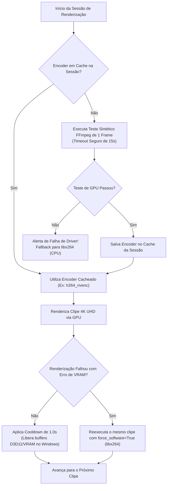

# Arquitetura & Engenharia: Aceleração por Hardware & GPU Probing

O processamento de vídeos em alta resolução (4K UHD a 3840x2160 a 60 FPS com filtros Lanczos e Deband) impõe uma demanda computacional massiva na CPU. Um timelapse longo ou um lote com 30 vídeos de pássaros levaria horas para ser codificado puramente via software (`libx264`).

O IRIS implementa uma arquitetura de **GPU First com Fallback Resiliente**, sondando os aceleradores de hardware disponíveis no sistema operacional e contornando as falhas conhecidas de drivers de vídeo no Windows.

---

## 1. Motores de Aceleração Suportados

O sistema suporta três ecossistemas de hardware dedicados, além da codificação em software:

| Backend | Encoder FFmpeg | Fabricante | Descrição |
| :--- | :--- | :--- | :--- |
| **NVENC** | `h264_nvenc` | NVIDIA | Codificador de silício dedicado em placas GeForce / Quadro / RTX. Altíssima velocidade com baixo consumo de CPU. |
| **Intel QSV** | `h264_qsv` | Intel | Quick Sync Video presente nos processadores Intel Core (Direct3D11 / OneVPL). |
| **AMD AMF** | `h264_amf` | AMD | Advanced Media Framework presente nas GPUs AMD Radeon. |
| **Software** | `libx264` | CPU (Fallback) | Codificador de referência executado em todos os núcleos da CPU caso a GPU falhe ou esteja desabilitada. |

---

## 2. O Problema da Instabilidade de GPU em Lotes Longos

Durante a codificação de dezenas de clipes sequenciais em placas de vídeo de consumo, identificou-se um problema crítico de engenharia:
- Quando o FFmpeg é disparado repetidamente em loops rápidos para processar dezenas de clipes unitários, o driver gráfico do Windows (Direct3D11 / WDDM) pode não desalocar a memória de contexto gráfico (VRAM) instantaneamente.
- Em clipes consecutivos, a sondagem rápida de hardware da sessão seguinte recebia um erro de timeout da API do driver, forçando a queda equivocada para CPU (`libx264`).
- Se o processo da CPU fosse iniciado, a máquina perdia a vantagem de velocidade da GPU até o final do lote.

---

## 3. As Soluções de Engenharia do IRIS

### 1. Cache de Sessão de Encoder
O encoder é testado uma única vez na inicialização da sessão com timeout estendido de 15 segundos. Uma vez comprovado que o hardware está funcional, o resultado é cacheado em memória, evitando centenas de sondagens redundantes no driver gráfico.

### 2. Cooldown de VRAM de 1.0 Segundo
Entre a renderização de um vídeo e o início do próximo no módulo `video_edit`, o IRIS introduz propositalmente uma pausa de 1.0 segundo (`time.sleep(1.0)`). Esse breve intervalo é suficiente para que o subsistema Direct3D11 do Windows libere completamente os handles de memória da GPU e os buffers de textura antes da próxima inicialização.

### 3. Fallback Automático em Tempo de Execução (`force_software=True`)
Se mesmo assim um clipe específico estourar o limite de VRAM da GPU durante a renderização (ex: devido a uma resolução atípica ou pico de memória de outro programa aberto na máquina), o manipulador de exceções captura a falha e reexecuta **aquele clipe específico** imediatamente em software via `libx264`, sem interromper o lote inteiro.
