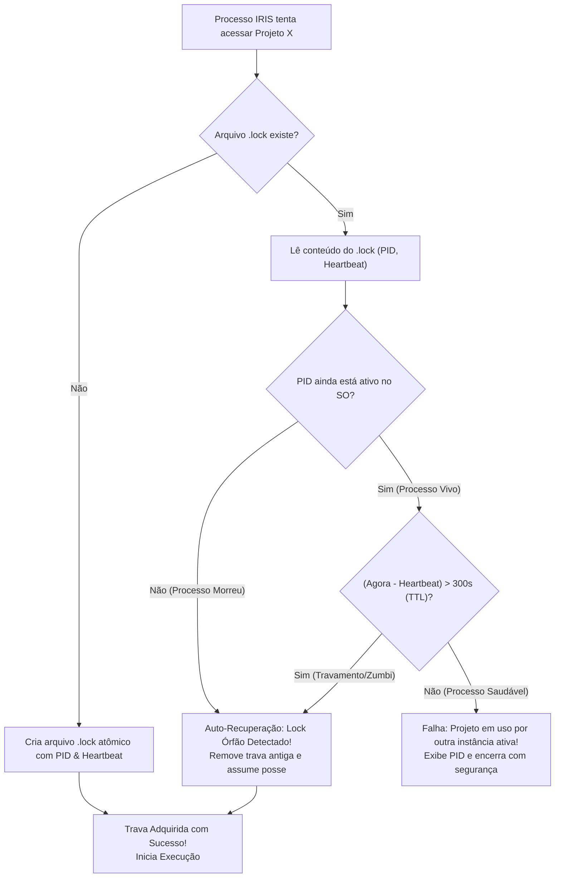

# Arquitetura & Engenharia: Concorrência & Locks (`ProjectLock`)

É comum que o usuário queira executar múltiplos processos do IRIS simultaneamente no mesmo computador — por exemplo:
- Um terminal processando o empilhamento de astrofotografia lunar (`iris-astro`).
- Outro terminal realizando a ingestão de um novo cartão SD no projeto `2026-10-14_GOPRO`.
- Um terceiro terminal renderizando um timelapse em lote de um projeto anterior.

Sem um controle rígido de concorrência, duas instâncias poderiam tentar manipular o mesmo projeto ao mesmo tempo, corrompendo arquivos e gerando condições de corrida (*race conditions*).

---

## 1. O Mecanismo `ProjectLock`

O IRIS implementa um sistema de exclusão mútua distribuído baseado em arquivos de lock atômicos (`<projeto>.lock`), contendo um payload estruturado em JSON com telemetria do processo titular da trava:

```json
{
  "pid": 14228,
  "hostname": "WORKSTATION-01",
  "created_at": 1760401200.0,
  "heartbeat": 1760401245.0,
  "project_name": "2026-10-14_GOPRO"
}
```

---

## 2. Diagrama de Aquisição e Liberação de Lock



---

## 3. Resiliência: Lidando com Locks Órfãos (*Stale Locks*)

Um problema frequente em sistemas de lockfile ocorre quando o processo morre abruptamente (ex: queda de energia, encerramento forçado via Gerenciador de Tarefas do Windows ou `kill -9` no Linux). Nesse cenário, o arquivo `.lock` permanece gravado em disco indefinidamente.

O `ProjectLock` resolve isso através de uma verificação dupla:

### 1. Checagem de Liveness de PID do Sistema Operacional
Utilizando `psutil` ou chamadas nativas da API do Windows (`kernel32.OpenProcess`), o IRIS verifica se o número do PID registrado no arquivo realmente corresponde a um processo ativo no sistema. Se o processo não existir mais, o lock é considerado órfão e removido imediatamente.

### 2. Time-To-Live (TTL) e Thread de Heartbeat
Durante a execução de um estágio longo (como a renderização de um timelapse que leva 20 minutos), uma thread em segundo plano atualiza o campo `heartbeat` a cada 30 segundos. Caso um processo fique congelado em um deadlock e não atualize o heartbeat por mais de **300 segundos (5 minutos)**, outras instâncias do IRIS são autorizadas a reivindicar a trava após registrar uma advertência no log.

---

## 4. Uso Elegante com Context Manager (`with`)

No código Python, o `ProjectLock` é consumido como um gerenciador de contexto, garantindo que a trava seja liberada no bloco `finally` mesmo em caso de exceções não tratadas:

```python
with ProjectLock(project_name, project_dir):
    # Execução das etapas críticas do projeto
    runner.run_stage(project, "timelapse")
# O arquivo .lock é removido automaticamente ao sair do bloco
```
