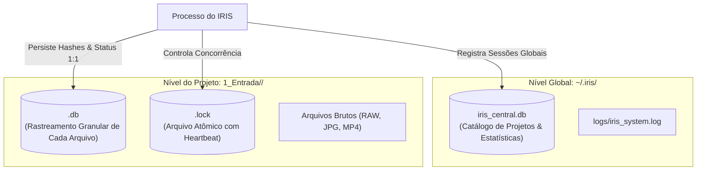

# Arquitetura & Engenharia: Persistência ACID & SQLite Duplo

Em pipelines de processamento pesado com milhares de arquivos, gerenciar estado em arquivos de texto (como `state.json`) é uma das fontes mais comuns de corrupção:
- Quedas de energia durante a reescrita do JSON corrompem a estrutura do documento.
- Carregar um JSON com 50.000 fotos na memória consome centenas de megabytes desnecessários e impede concorrência.
- Não há propriedades ACID (Atomicidade, Consistência, Isolamento, Durabilidade).

Para resolver definitivamente esse gargalo, o IRIS adota uma arquitetura relacional de **Dois Níveis de SQLite (Dual-Database)** operando em **Modo WAL (Write-Ahead Logging)**.

---

## 1. Topologia de Dois Níveis: Central vs Projeto



---

## 2. O Banco Central (`iris_central.db`)

Fica alocado no diretório global do usuário (`~/.iris/` ou `%USERPROFILE%\.iris\`) e armazena metadados de alto nível sobre todos os projetos e pipelines executados no computador.

### Tabela `projects`
Guarda a lista de todas as sessões já criadas:
- `id`: Identificador inteiro autoincrementado.
- `name`: Nome exclusivo da sessão (ex: `2026-10-14_Timelapses`).
- `source_path`: Diretório de origem original (ex: `G:\DCIM\100GOPRO`).
- `dest_path`: Diretório de destino no SSD (ex: `C:\IRIS\1_Entrada\2026-10-14_Timelapses`).
- `current_stage_id`: Estágio em que o projeto parou (ex: `organize`, `timelapse`, `completed`).
- `status`: Estado atual (`in_progress`, `completed`, `error`).
- `total_files`, `total_bytes`: Métricas consolidadas de volume.
- `created_at`, `updated_at`: Timestamps ISO de auditoria.

### Benefício:
Permite que o usuário abra a CLI e veja instantaneamente todos os projetos anteriores em uma tabela formatada, sabendo exatamente em que etapa cada um se encontra, sem precisar vasculhar o sistema de arquivos.

---

## 3. O Banco de Projeto (`<projeto>.db`)

Cada sessão de ingestão possui seu próprio arquivo SQLite individual, localizado na raiz da pasta do projeto. 

### Principais Vantagens do Isolamento:
1. **Performance Desacoplada:** O banco central não cresce indefinidamente nem vira um ponto único de contenção de travas de I/O.
2. **Portabilidade:** Ao arquivar, mover ou fazer backup da pasta do projeto para um HD externo, o banco de dados viaja junto com os arquivos. Todo o histórico de hashes, metadados de câmera e IDs do YouTube é preservado.
3. **Descarte Limpo:** Para excluir um projeto completamente, basta deletar sua pasta; não há necessidade de executar rotinas complexas de limpeza em um banco de dados centralizado.

---

## 4. O Modo WAL (Write-Ahead Logging)

Por padrão, o SQLite opera com *rollback journal*, o que bloqueia leituras durante escritas e é vulnerável a lentidão em discos mecânicos.

O IRIS inicializa todas as conexões SQLite configurando explicitamente:
```python
conn.execute("PRAGMA journal_mode=WAL;")
conn.execute("PRAGMA synchronous=NORMAL;")
conn.execute("PRAGMA busy_timeout=5000;")
```

### Por que WAL?
- **Concorrência Leitor-Escritor:** Operações de leitura (ex.: a CLI consultando status de arquivos) não bloqueiam operações de escrita (ex.: a thread de cópia salvando hashes recém-calculados), e vice-versa.
- **Performance I/O:** As escritas são agregadas sequencialmente no arquivo `-wal`, minimizando operações aleatórias de seek no SSD.
- **Busy Timeout de 5 Segundos:** Em caso de leve disputa entre threads, a conexão aguarda até 5 segundos em vez de disparar uma exceção de `sqlite3.OperationalError: database is locked`.
