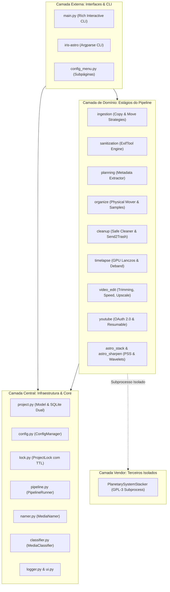

# Arquitetura & Engenharia: Princípios de Design de Software

A arquitetura do IRIS foi desenhada para superar as fragilidades comuns de scripts caseiros de automação de mídia (como falta de tratamento de exceções, acoplamento entre regras de negócio e interfaces, dependência de variáveis globais e ausência de tolerância a falhas). 

O sistema aplica rigorosamente princípios consolidados da Engenharia de Software Moderna, como **Clean Architecture**, **SOLID**, **Pipeline Pattern**, **Strategy Pattern** e **Fail-Fast**.

---

## 1. Visão Geral da Clean Architecture

O código é estruturado em três camadas conceituais concêntricas com limites estritos de dependência:



### Regras de Limite Arquitetural:
1. **Isolamento de Projeto:** Um estágio (`PipelineStage`) só pode processar itens pertencentes ao `Project` que lhe foi passado. É expressamente proibido fazer varreduras em diretórios globais como fallback para encontrar trabalho. Se um projeto não possuir itens da categoria esperada, o estágio deve retornar `True` graciosamente e não interferir em outros diretórios.
2. **Independência de Interface:** Todo estágio de domínio funciona 100% de forma programática através da chamada `stage.run(project, **kwargs)`. Nenhuma regra de negócio depende do console Rich ou de menus visuais.

---

## 2. Princípios SOLID Aplicados

### S — Single Responsibility Principle (Princípio da Responsabilidade Única)
Cada classe possui uma única razão para mudar:
- `Project`: gerencia estritamente o estado relacional do lote de mídia e transações SQLite.
- `ProjectLock`: gerencia exclusivamente o ciclo de vida do arquivo de lock e concorrência multissessão.
- `LunarWaveletEngine`: executa exclusivamente as transformações matemáticas de wavelets em tensores 2D/3D no OpenCV.
- `YouTubeUploader`: gerencia estritamente a comunicação HTTP de upload em chunks com os servidores do Google.

### O — Open/Closed Principle (Princípio Aberto/Fechado)
O pipeline é aberto para extensão, mas fechado para modificação. Novos módulos podem ser plugados apenas:
1. Criando uma classe que herda de `PipelineStage`.
2. Adicionando uma entrada no arquivo `config.yaml` sob `pipeline.stages`.
O `PipelineRunner` carrega e invoca os estágios dinamicamente via reflexão (`importlib`), sem necessidade de alterar o código do orquestrador.

### L — Liskov Substitution Principle (Princípio da Substituição de Liskov)
Toda implementação de `IngestionStrategy` (`CopyStrategy` ou `MoveStrategy`) pode ser intercambiada pelo `IngestionStage` sem que o consumidor precise saber qual algoritmo está sendo executado por baixo dos panos.

### I — Interface Segregation Principle (Princípio da Segregação de Interfaces)
A classe base `PipelineStage` define um contrato mínimo e enxuto:
```python
class PipelineStage(ABC):
    def __init__(self, stage_id: str, name: str):
        self.stage_id = stage_id
        self.name = name

    @abstractmethod
    def run(self, project: Project, **kwargs) -> bool:
        pass
```
A reflexão em `_invoke_stage` inspeciona a assinatura de `run` e injeta apenas os parâmetros que aquele estágio específico aceita, impedindo que classes sejam sobrecarregadas com argumentos desnecessários.

### D — Dependency Inversion Principle (Princípio da Inversão de Dependências)
O orquestrador (`PipelineRunner`) depende da abstração de alto nível `PipelineStage`, e não de implementações concretas dos módulos.

---

## 3. Padrões de Projeto (Design Patterns)

### Pipeline Pattern & Chain of Responsibility
O fluxo sequencial de processamento é modelado como uma cadeia de estágios. Cada estágio recebe o estado do projeto, executa suas transformações, persiste os novos metadados no SQLite e passa o controle adiante. Se um estágio falhar ou for interrompido pelo usuário (`Ctrl+C`), a execução é abortada de forma segura e o progresso até aquele ponto é registrado no banco.

### Strategy Pattern
A etapa de ingestão de mídias desacopla o algoritmo de movimentação da execução da etapa:
```python
class IngestionStrategy(ABC):
    @abstractmethod
    def execute(self, project: Project, source_dir: str, target_dir: str, **kwargs) -> bool:
        pass
```
Isso permite alternar facilmente entre o modo tradicional e seguro `copy` (Copy & Verify chunkado com `os.fsync`) e o modo ultra-rápido `move` (MoveStrategy em 5 fases).

### Subprocess Isolation (Isolamento de Processo)
A integração com softwares de terceiros e licenças virais (como o PlanetarySystemStacker, distribuído sob GPL-3) não utiliza importação direta de bibliotecas Python no mesmo processo em tempo de execução. O IRIS dispara o PSS como um **subprocesso isolado** (`subprocess.Popen`), comunicando-se exclusivamente via argumentos de linha de comando e leitura de arquivos gerados no disco. Isso garante que:
1. Falhas de segmentação ou vazamentos de memória em bibliotecas gráficas (PyQt5) do PSS não derrubem o interpretador do IRIS.
2. A licença MIT do IRIS permaneça desacoplada da licença GPL-3 do software empilhador.
