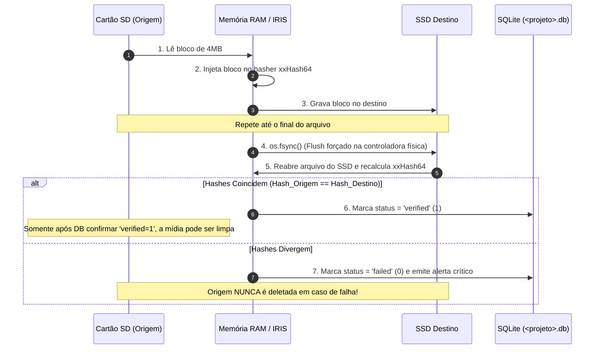

# Arquitetura & Engenharia: O Princípio Zero Data Loss

No domínio de fotografia e filmagem de natureza, uma captura perdida muitas vezes é **irrecuperável** (o rasante de uma ave rara, as cores de um amanhecer único ou uma conjunção astronômica que não se repetirá em anos).

Por essa razão, o **Zero Data Loss (Prevenção Absoluta de Perda de Dados)** não é apenas uma diretriz, mas o **axioma central de design** em torno do qual toda a arquitetura de I/O do IRIS foi construída.

---

## 1. O Problema da Cópia Ingênua e Corrupção Silenciosa

Sistemas operacionais e scripts simples de cópia frequentemente sofrem de falhas silenciosas (*silent bit rot* ou *silent drop*):
- Cabos USB frouxos ou leitores de cartão SD superaquecidos podem alterar bits durante a transferência sem disparar exceção de I/O.
- Buffers de escrita em memória RAM (Write Cache) do Sistema Operacional confirmam para a aplicação que o arquivo "foi gravado", mas os bytes ainda estão em trânsito na memória volátil. Se houver queda de energia ou desconexão imediata do drive, o arquivo de destino fica truncado ou corrompido em disco.
- Se o script apagar a origem imediatamente após a cópia da aplicação sem forçar a sincronização de hardware, a mídia original é destruída para sempre.

---

## 2. A Solução: Os Cinco Pilares de Salvaguarda do IRIS



### Pilar 1: Cálculo Simultâneo de Hash na Memória RAM
A abordagem comum para conferir cópia lê a origem para calcular hash, copia o arquivo e depois lê o destino para comparar. Isso exige **3 passadas completas de leitura no disco**.
No IRIS:
- O arquivo é lido da origem em chunks de **4MB**.
- Cada chunk é imediatamente submetido ao acumulador de hash na memória RAM e em seguida gravado no arquivo de destino.
- Ao término da cópia, o hash da origem já está 100% computado sem exigir uma leitura separada prévia.
- **Resultado:** Apenas 2 leituras de disco, reduzindo o tempo de I/O em 33% sem perda de segurança.

### Pilar 2: `os.fsync()` — Garantia de Gravação Física
Para neutralizar o risco de o sistema operacional enganar a verificação lendo dados do cache da memória RAM, o IRIS executa obrigatoriamente a chamada de baixo nível:
```python
dest_file.flush()
os.fsync(dest_file.fileno())
```
Isso força a controladora de disco físico do SSD/HD a esvaziar todos os seus buffers internos para as células de memória não-volátil antes de o IRIS abrir o arquivo de destino para leitura de verificação.

### Pilar 3: O Algoritmo `xxHash64`
O sistema emprega o algoritmo **xxHash64**, cuja velocidade de processamento atinge múltiplos gigabytes por segundo por núcleo de CPU (limitado unicamente pela largura de banda da memória RAM). Ao contrário de funções criptográficas lentas como SHA-256 ou MD5, o cálculo de integridade no IRIS não introduz gargalo de CPU durante a transferência.

### Pilar 4: Transações ACID no SQLite antes de Qualquer Limpeza
O estágio de limpeza da mídia de origem (`CleanupStage`) não toma decisões com base no retorno da função de cópia na memória. Ele realiza uma consulta SQL formal no banco de dados do projeto:
```sql
SELECT COUNT(*) FROM files WHERE verified = 0;
```
Se houver qualquer registro com `verified == 0` ou se o número de arquivos verificados for menor do que o número de arquivos detectados no escaneamento original, a limpeza é **imediatamente abortada**.

### Pilar 5: Destruição Segura com Envio para a Lixeira (`Send2Trash`)
Mesmo quando a verificação atesta 100% de integridade e a limpeza é acionada, o IRIS não executa `os.unlink()` diretamente por padrão. Ele envia os arquivos para a Lixeira do Sistema Operacional através da biblioteca `send2trash`. Caso o usuário perceba que acionou a limpeza por engano, os arquivos podem ser recuperados com um clique na Lixeira do Windows.
