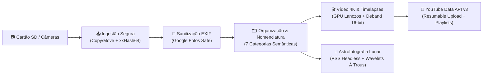

# IRIS — Imaging Resources and Integration System

<p align="center">
  <strong>Central de Engenharia e Automação de Mídia para Fotografia, Vídeo 4K, Astrofotografia Lunar e YouTube</strong>
</p>

<p align="center">
  
  
  
  
  
  
</p>

---

## O que é o IRIS?

O **IRIS (Imaging Resources and Integration System)** é uma plataforma autônoma de linha de comando (CLI) desenvolvida para gerenciar, com rigor militar de integridade e automação de ponta a ponta, todo o ciclo de vida de produção audiovisual pessoal de natureza. 

O sistema substitui rotinas manuais fragmentadas (cópias lentas de cartões de memória, inspeção de arquivos corrompidos, corte e trimming de clipes, renderização de timelapses 4K, empilhamento manual de fotografias lunares e upload no YouTube com preenchimento manual de formulários) por um **pipeline de software unificado, idempotente e resiliente a falhas**.



---

## Princípios Inegociáveis do Sistema

> [!IMPORTANT]
> ### 1. Zero Data Loss (Prevenção Absoluta de Perda de Dados)
> O IRIS adota o axioma de que nenhum byte de mídia original pode ser destruído sem uma comprovação matemática prévia de que uma réplica 100% íntegra já está persistida em disco definitivo. Todas as deleções utilizam verificação cruzada de hashes (`xxh64`) e envio prioritário para a Lixeira do Sistema Operacional (`Send2Trash`).

> [!TIP]
> ### 2. Arquitetura Dual-Database SQLite com Modo WAL
> O rastreamento de estado não depende de arquivos voláteis como JSON ou variáveis em memória. O sistema opera com dois bancos relacionais com propriedades ACID:
> - **Banco Central (`iris.db`)**: Guarda o catálogo de projetos, estatísticas globais e status de jobs.
> - **Banco por Projeto (`<projeto>.db`)**: Isola transações individuais por lote de fotos, eliminando concorrência destrutiva e garantindo retomabilidade instantânea pós-queda de energia.

> [!NOTE]
> ### 3. Aceleração por Hardware Resiliente (GPU First, CPU Fallback)
> Para renderização de timelapses e upscale de vídeos para 4K UHD (3840x2160), o IRIS investiga dinamicamente a presença de chips gráficos dedicados (NVIDIA NVENC, Intel QSV ou AMD AMF). Possui um motor com cache de sondagem, cooldown de VRAM entre clipes e transição transparente para software (`libx264`) se houver instabilidade no driver Direct3D11/OneVPL.

---

## Mapa da Documentação

A documentação está dividida em 5 pilares para leitura por engenheiros, entusiastas e agentes autônomos de IA:

| Seção | Descrição | Tópicos Principais |
| :--- | :--- | :--- |
| **[Visão Geral](visao-geral/introducao.md)** | Introdução ao sistema, câmeras e setup. | Equipamentos catalogados, menu interativo, guia rápido da CLI. |
| **[Arquitetura & Engenharia](arquitetura/principios-de-design.md)** | Fundamentos de software e decisões técnicas. | Clean Architecture, SOLID, Pipeline Pattern, Strategy Pattern, Locks atômicos, ADRs. |
| **[Módulos do Pipeline](modulos/01-ingestao.md)** | Deep Dive em cada uma das etapas do sistema. | Ingestão, Sanitização EXIF, Organização, Timelapse 4K, Edição 4K, YouTube, Astro Stack e Wavelets. |
| **[IA & Engenharia](ia-e-engenharia/contexto-para-ia.md)** | Especificação formal para agentes de IA e desenvolvedores. | Modelo de entidades, invariantes, suíte de 157 testes em `pytest`, guia de novos estágios, `llms.txt`. |
| **[Referência Técnica](referencia/schema-banco-de-dados.md)** | Dicionários de dados e diagramas de estado. | Schemas SQLite, tabelas `files`, `timelapses`, `edited_videos`, `astro_stacks`, ciclo de vida. |

---

## Início Imediato

Clone o repositório e instale as dependências essenciais:

```bash
git clone https://github.com/felipeph/IRIS.git
cd IRIS
pip install -r iris/requirements.txt
```

Para usufruir do pipeline astronômico de alta fidelidade:

```bash
pip install -r iris/requirements-astro.txt
```

Inicie o assistente interativo:

```bash
python iris/main.py
```
