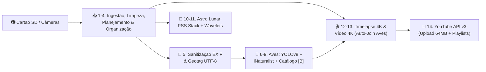

# IRIS — Imaging Resources and Integration System

  <strong>Central de Engenharia e Automação de Mídia para Fotografia, Ornitologia por IA, Vídeo 4K, Astrofotografia Lunar e YouTube</strong>

  
  
  
  
  
  

---

## O que é o IRIS?

O **IRIS (Imaging Resources and Integration System)** é uma plataforma autônoma de linha de comando (CLI) desenvolvida para gerenciar, com rigor de integridade e automação de ponta a ponta, todo o ciclo de vida de produção audiovisual de natureza e astrofotografia.

---

## Princípios Inegociáveis do Sistema

> [!IMPORTANT]
> ### 1. Zero Data Loss (Prevenção Absoluta de Perda de Dados)
> Nenhum byte de mídia original pode ser destruído sem comprovação matemática prévia (`xxHash64`) de que uma réplica íntegra está persistida no SSD. Arquivos RAW e vídeos originais jamais são alterados fisicamente por ferramentas de metadados.

> [!TIP]
> ### 2. Arquitetura Dual-Database SQLite com Modo WAL
> O rastreamento de estado opera com dois bancos relacionais ACID (`PRAGMA user_version = 2`):
> - **Banco Central (`iris_central.db`)**: Guarda o catálogo de projetos, catálogo taxonômico global (`species_catalog`) e histórico consolidado de mídias.
> - **Banco por Projeto (`<projeto>.db`)**: Isola transações por lote com suporte a `SAVEPOINT` e *Dual-Write* atômico via `ATTACH DATABASE`.

> [!NOTE]
> ### 3. Visão Computacional Híbrida & Aceleração por Hardware
> - **Ornitologia & Geolocalização**: Detecção local via YOLOv8s combinada à API de Visão Computacional do iNaturalist com prior geográfico (`GeoService`), consenso e *early exit* em rajadas, e revisão interativa com catálogo regional.
> - **GPU First, CPU Fallback**: Renderização 4K UHD (3840x2160) via NVIDIA NVENC, Intel QSV ou AMD AMF com fallback transparente para software (`libx264`).

---

## Mapa da Documentação

| Seção | Descrição | Tópicos Principais |
| :--- | :--- | :--- |
| **[Visão Geral](visao-geral/introducao.md)** | Introdução ao sistema, câmeras e setup. | Equipamentos catalogados, menu interativo em 9 subpáginas, guia rápido. |
| **[Arquitetura & Engenharia](arquitetura/principios-de-design.md)** | Fundamentos de software e decisões técnicas. | Clean Architecture, SOLID, Dual SQLite, Locks atômicos, ADRs. |
| **[Módulos do Pipeline](modulos/01-ingestao.md)** | Deep Dive nas etapas do sistema. | Ingestão, Organização, Sanitização & Geo, Aves (YOLO + iNaturalist), Timelapse 4K, Vídeo 4K, Astro e YouTube. |
| **[IA & Engenharia](ia-e-engenharia/contexto-para-ia.md)** | Especificação formal para agentes de IA e manutenção. | Mapa modular do código, invariantes, suíte de 380+ testes em `pytest`, `llms.txt`. |
| **[Referência Técnica](referencia/pipeline-lifecycle.md)** | **Matriz Mestre do Pipeline** e Dicionário SQLite. | Mapeamento Etapa $\rightarrow$ Módulo `.py` $\rightarrow$ Tabelas SQLite $\rightarrow$ Pastas `C:\IRIS`. |
