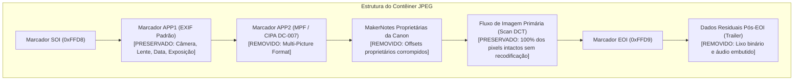

# Módulo 02: Sanitização EXIF para Google Fotos (`sanitization`)

O estágio de Sanitização (`SanitizationStage`) realiza a higienização cirúrgica de metadados binários em fotografias JPEG, tornando-as 100% compatíveis com o transcodificador de nuvem do modo **Economia de Armazenamento (Storage Saver)** do Google Fotos.

---

## 1. O Problema da Incompatibilidade com o Google Fotos

Quando uma imagem é enviada ao Google Fotos no modo *Economia de Armazenamento*, ela é submetida a um pipeline em nuvem de compressão de alta eficiência (baseado em decodificadores estritos como `libjpeg-turbo` e `MozJPEG`).

Se o decodificador encontrar segmentos de metadados fora do padrão TIFF/EXIF estrito, formatos multi-imagem proprietários ou corrupção de offsets, ele aborta a compressão para proteger a foto. No entanto, em vez de descartar o arquivo, o Google Fotos adota um comportamento de salvaguarda indesejado:
- Salva o arquivo em **Qualidade Original**.
- Marca a foto como *"Incompatível com a Economia de armazenamento"*.
- Debita o peso bruto do arquivo original (ex.: 6.0 MB em vez de ~400 KB) da cota de armazenamento da conta do usuário.

Em câmeras da linha **Canon PowerShot** (como a SX60 HS), esse erro é extremamente frequente mesmo em fotos comuns tiradas no modo automático.

---

## 2. Anatomia dos Elementos Problemáticos no Contêiner JPEG

O IRIS identifica e remove cirurgicamente quatro anomalias comuns em câmeras Canon e celulares:



1. **Bloco MPF (*Multi-Picture Format* / Segmento APP2 `0xFFE2`):**
   Encapsula ponteiros para múltiplos fluxos de imagem dentro do mesmo arquivo (usado para pré-visualizações de disparo contínuo). O Google rejeita explicitamente imagens com MPF para compressão destrutiva.
2. ***MakerNotes* Proprietárias da Canon:**
   Blocos proprietários de telemetria interna da lente e do sensor. Em fotos com zoom extremo da SX60 HS, esses offsets frequentemente ultrapassam os limites padrão do TIFF, quebrando parsers estritos.
3. **Dados de Trailer (*Data Past EOI*):**
   Bytes gravados fisicamente após o marcador final `0xFFD9` (EOI). O Google descarta a conversão para evitar corromper payloads não reconhecidos.
4. **Fluxos Secundários de Imagem (*Embedded Previews*):**
   Miniaturas e pré-visualizações de média resolução embutidas que causam conflito na detecção da resolução primária.

---

## 3. O Motor de Higienização (ExifTool sem Recompressão)

O IRIS executa a sanitização invocando o **Phil Harvey's ExifTool** com parâmetros especializados:

```bash
exiftool -overwrite_original -P -mpf:all= -MakerNotes:all= -trailer:all= "IMAGEM.JPG"
```

### Por que essa abordagem é superior?
- **Zero Degradação Visual:** A imagem não é reaberta nem recodificada pelo Pillow ou OpenCV. O fluxo de compressão DCT dos pixels permanece **bit a bit idêntico** ao original da câmera.
- **Preservação de EXIF Essencial:** Tags vitais como modelo da câmera, data/hora da captura, distância focal, abertura, ISO e tempo de exposição são mantidas intactas no segmento APP1.

---

## 4. Recálculo e Sincronização de Estado no SQLite

Como a remoção dos blocos MPF e trailers altera o tamanho do arquivo em alguns kilobytes e, consequentemente, modifica seu hash binário, o `SanitizationStage` recalcula imediatamente o novo `xxHash64` e o novo `size_bytes`, atualizando o registro de forma atômica no banco SQLite do projeto:

```python
new_hash = compute_xxhash64(file_path)
new_size = os.path.getsize(file_path)

db.execute(
    "UPDATE files SET xxhash64 = ?, size_bytes = ? WHERE id = ?",
    (new_hash, new_size, file_id)
)
```
Isso garante que todas as etapas subsequentes do pipeline (organização e limpeza) trabalhem com o hash atualizado e auditável.
