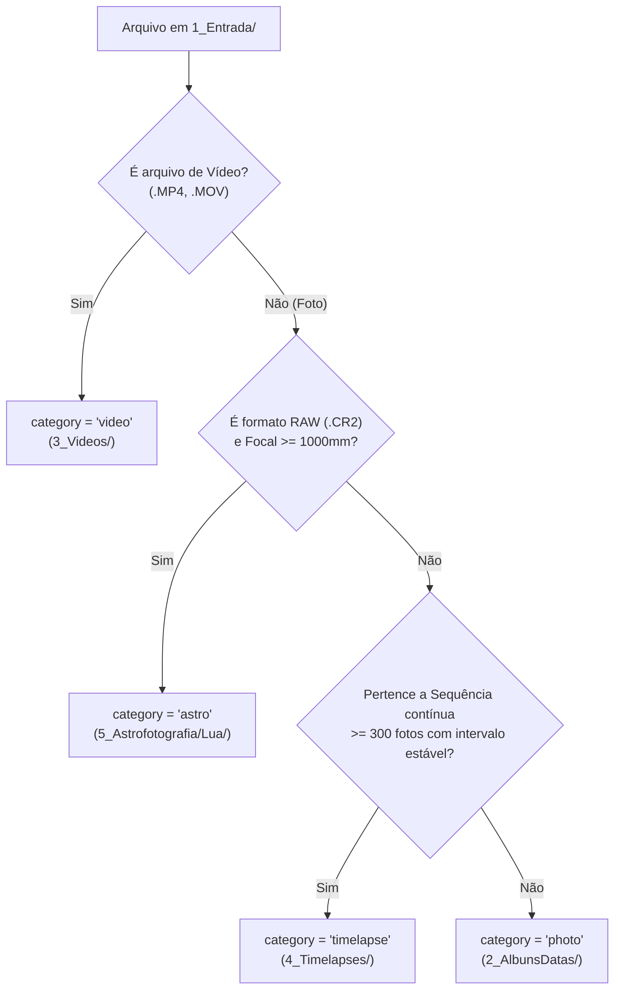

# Módulo 03: Planejamento & Extração de Metadados (`planning`)

O estágio de Planejamento (`PlanningStage`) atua como a inteligência analítica que inspeciona todos os arquivos presentes no *staging* (`1_Entrada/`), extrai suas propriedades ópticas e físicas, infere a câmera de origem e determina a qual categoria de destino cada mídia pertence.

---

## 1. O Pipeline de Extração de Metadados

Para cada arquivo no lote, o extrator (`src/core/metadata.py`) analisa o cabeçalho binário de acordo com a extensão:
- **Fotos JPEG e RAW (`.JPG`, `.CR2`):** Leitura de tags EXIF (DateTimeOriginal, Make, Model, FocalLength, FNumber, ExposureTime, ISOSpeedRatings, ImageWidth, ImageLength).
- **Vídeos (`.MP4`, `.MOV`):** Inspeção dos átomos QuickTime / MP4 (moov, mvhd, tkhd) via `TinyTag` ou `ffprobe` para obter largura, altura, duração em segundos, taxa de quadros (FPS) e codec de vídeo.

---

## 2. Inferência Heurística da Câmera (`MediaClassifier`)

O classificador analisa a combinação de tags EXIF e características ópticas para normalizar o identificador da câmera em um padrão canônico:

| Identificador Canônico | Critérios Heurísticos |
| :--- | :--- |
| `CANON_SX60HS` | Make contém "Canon" E Model contém "SX60" |
| `GOPRO_HERO5` | Model contém "HERO5" OU Make contém "GoPro" |
| `CANON_S50_CHDK` | Model contém "S50" (ou tags gravadas por scripts CHDK) |
| `CANON_T6` | Model contém "Rebel T6" ou "EOS 1300D" |
| `SMARTPHONE` | Make contém "Apple", "Samsung", "Xiaomi", "Motorola" |

---

## 3. Algoritmo de Categorização Automática

O `PlanningStage` aplica regras condicionais para categorizar cada arquivo:

### Detecção de Sequências de Timelapse:
Para detectar se um lote de fotos forma um timelapse sem exigir que o usuário informe manualmente:
1. O sistema ordena todas as fotos da mesma câmera cronologicamente pelo timestamp EXIF.
2. Calcula o delta temporal $\Delta t$ entre fotos consecutivas.
3. Se um agrupamento contiver pelo menos **300 fotos** (`timelapse_min_photos`) com delta temporal menor que **60 segundos** (`timelapse_max_interval_seconds`) e variação de intervalo estável (proporção de tolerância <= 1.5x), o agrupamento é classificado como `timelapse`.

---

## 4. Persistência de Planejamento

Ao término do planejamento, o objeto `Project` tem sua coleção em memória `project.items` populada com instâncias de `MediaItem`. 

O banco de dados do projeto tem as colunas `category`, `camera_model`, `capture_date`, `width`, `height`, `focal_length` e `exposure` atualizadas, preparando o lote para a movimentação física no estágio seguinte.
