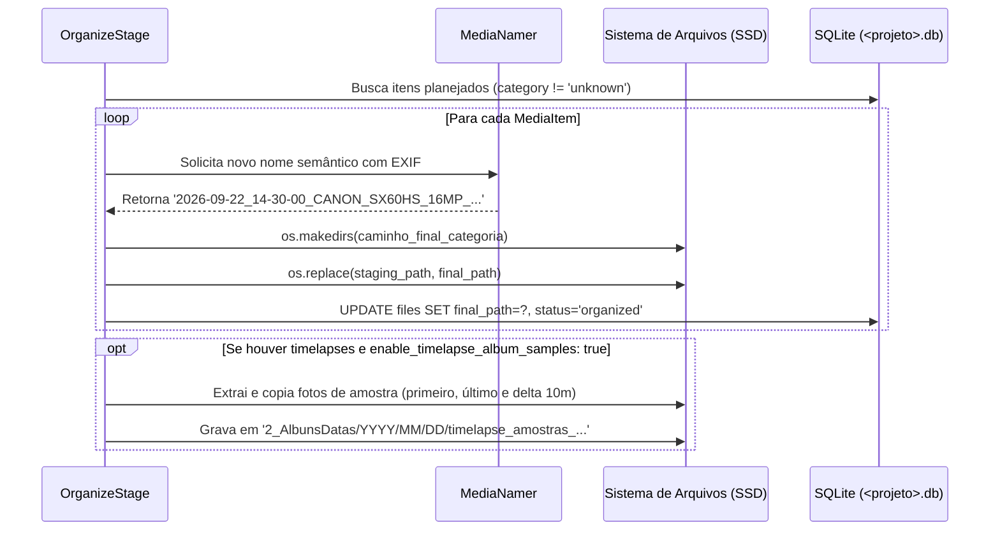

# Módulo 04: Organização Física & Nomenclatura (`organize`)

O estágio de Organização Física (`OrganizeStage`) é responsável por tirar os arquivos da pasta temporária de *staging* (`1_Entrada/<projeto>/`) e movê-los definitivamente para a estrutura de diretórios final do acervo, aplicando o padrão de nomenclatura enriquecido com metadados.

---

## 1. Fluxo de Execução

---

## 2. Regras de Distribuição Física por Categoria

A partir da categoria atribuída no planejamento, o destino é montado com particionamento cronológico baseado na data real de captura (`DateTimeOriginal`):

1. **Fotos Comuns (`category == 'photo'`):**
   `2_AlbunsDatas/YYYY/MM/DD/<novo_nome_rico>.JPG`
2. **Vídeos Convencionais (`category == 'video'`):**
   `3_Videos/YYYY/MM/DD/<novo_nome_rico>.MP4`
3. **Sequências de Timelapse (`category == 'timelapse'`):**
   `4_Timelapses/<Camera>/YYYY/MM/DD/timelapse_YYYY-MM-DD_HH-MM-SS/<novo_nome_rico>.JPG`
   *Mantém todos os frames da mesma sessão isolados em sua subpasta temporal para posterior renderização.*
4. **Astrofotografia Lunar (`category == 'astro'`):**
   `5_Astrofotografia/Lua/YYYY/MM/DD/sessao_YYYY-MM-DD_HH-MM-SS/<novo_nome_rico>.CR2`

---

## 3. Extração Inteligente de Amostras de Timelapse

Quando milhares de fotos são categorizadas como timelapse, o acervo fotográfico de datas comuns (`2_AlbunsDatas/`) deixaria de refletir aquele momento especial do dia (um lindo pôr do sol, por exemplo).

O `OrganizeStage` executa um algoritmo dedicado:
- Identifica o frame com o menor timestamp (primeiro frame).
- Identifica o frame com o maior timestamp (último frame).
- Percorre a linha do tempo selecionando amostras espaçadas pelo intervalo configurado em `classification.timelapse_sample_interval_minutes` (padrão de 10 minutos).
- Copia essas fotos selecionadas para `2_AlbunsDatas/YYYY/MM/DD/timelapse_amostras_HH-MM-SS/`, preservando todos os atributos originais para visualização em galerias de fotos de celular ou nuvem.
