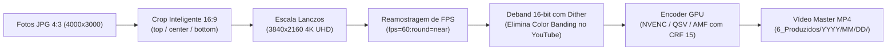

# Módulo 06: Renderização de Timelapse 4K UHD (`timelapse`)

O estágio de Timelapse (`TimelapseStage`) identifica sequências de centenas ou milhares de fotografias contíguas e as transforma automaticamente em vídeos master em altíssima definição **4K UHD (3840x2160)** a **60 FPS**, com aceleração gráfica por GPU e tratamento avançado de cores.

---

## 1. O Problema da Proporção de Tela (4:3 vs 16:9)

Câmeras fotográficas de sensor 1/2.3" (como a GoPro Hero 5 e a Canon SX60 HS) capturam fotos no formato clássico **4:3** (ex.: 4000x3000 ou 4608x3456). No entanto, o padrão moderno de exibição em televisores, monitores e no YouTube é **16:9** (4K UHD: 3840x2160).

Se uma imagem 4:3 for forçada em 16:9 sem tratamento, os objetos ficam achatados. Se forem aplicadas barras pretas laterais (*pillarbox*), a experiência visual em telas modernas é degradada.

### A Solução: Aspect Ratio Crop Inteligente com Lanczos
O IRIS aplica um corte milimétrico vertical na proporção 16:9, permitindo que o usuário escolha no `config.yaml` qual região da imagem deve ser priorizada através do parâmetro `crop_mode`:

```text
┌──────────────────────────────────────────────┐
│ [crop_mode: top]    - Prioriza Céu e Nuvens │
├──────────────────────────────────────────────┤
│ [crop_mode: center] - Corte Central Padrão   │
├──────────────────────────────────────────────┤
│ [crop_mode: bottom] - Prioriza Chão e Linha  │
│                       do Horizonte           │
└──────────────────────────────────────────────┘
```

A interpolação utiliza o algoritmo **Lanczos**, reconhecido na indústria por preservar arestas finas e textura de folhagens sem gerar borrões.

---

## 2. A Cadeia de Filtros FFmpeg

A renderização é orquestrada por uma complexa cadeia de filtros (*filtergraph*) construída dinamicamente pelo `renderer.py`:



---

## 3. O Filtro de Deband 16-Bit com Ruído Temporal (Anti-Banding)

Ao enviar timelapses de amanheceres ou crepúsculos para o YouTube, o céu frequentemente sofre de **color banding** (degradação em faixas concêntricas de cor causadas pela compressão agressiva de 8 bits do codec AVC1/H.264).

Para eliminar esse problema, o IRIS oferece um algoritmo de **Deband 16-bit com micro-dither**:
- Um filtro de deband suaviza os gradientes em precisão de 16-bit antes da quantização final.
- Uma camada infinitesimal de ruído estocástico (*temporal grain/dither*) é adicionada aos tons contínuos do céu.
- **Efeito Técnico:** O transcoder do YouTube detecta o micro-detalhe de alta frequência e é forçado a conceder bitrates muito superiores nos codecs **VP09** e **AV01**, preservando gradientes limpos e sem faixas no canal.

---

## 4. Persistência na Tabela `timelapses`

Cada vídeo renderizado com sucesso tem sua telemetria técnica persistida:

```sql
INSERT INTO timelapses (
    project_name,
    video_path,
    photo_count,
    resolution,
    crop_mode,
    encoder,
    duration_seconds,
    speedup_factor,
    status
) VALUES (?, ?, ?, '3840x2160', ?, ?, ?, ?, 'rendered');
```

---

## 5. Notificações Toast e NTFY

Ao concluir uma renderização (que pode levar vários minutos), o IRIS dispara notificações assíncronas para o usuário:
- **Windows Toast:** Notificação nativa no canto da tela do Windows com som e miniatura.
- **NTFY:** Push notification enviada via protocolo NTFY para o smartphone do usuário com nome do vídeo, resolução e duração.
