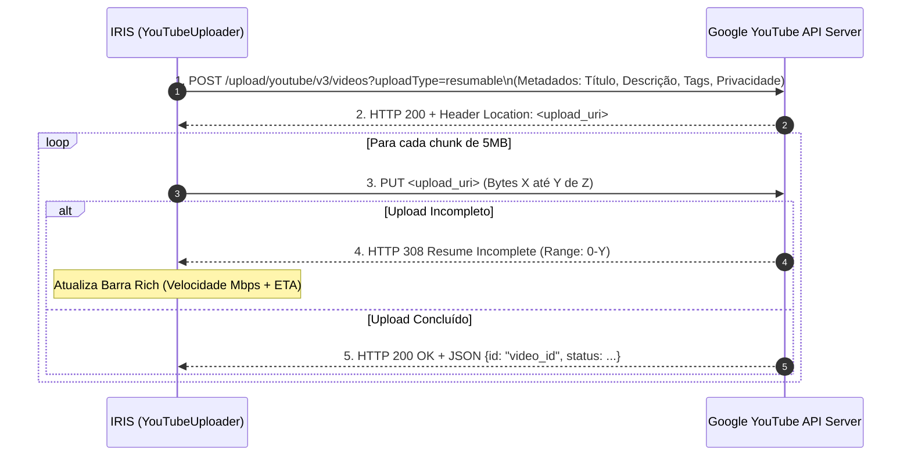

# Módulo 08: Publicação Automatizada no YouTube (`youtube`)

O estágio do YouTube (`YouTubeStage`) conclui o fluxo de produção do IRIS, realizando a autenticação via OAuth 2.0, upload em blocos (*Resumable Upload*), geração dinâmica de metadados técnicos ricos, vinculação a playlists e higienização pós-upload de arquivos locais.

---

## 1. Fluxo de Autenticação OAuth 2.0

O sistema utiliza a **YouTube Data API v3** oficial do Google:
1. O usuário armazena o arquivo de credenciais do Google Cloud Console em `iris/secrets/client_secrets.json`.
2. Na primeira execução, o IRIS abre uma janela no navegador para autorização do usuário nos escopos:
   - `https://www.googleapis.com/auth/youtube.upload`
   - `https://www.googleapis.com/auth/youtube`
3. O token de atualização (*refresh token*) é salvo de forma segura em `iris/secrets/token.json` (ignorado pelo `.gitignore`), permitindo renovações automáticas sem exigir novas confirmações manuais.

---

## 2. Upload Resumable em Chunks com Barra Rich

Para arquivos pesados em 4K UHD, o upload via HTTP simples é propenso a interrupções. O IRIS implementa o protocolo de **Resumable Upload em Chunks de 5MB**:



Em caso de instabilidade transitória de rede, o uploader aplica **Exponential Backoff** de até 5 tentativas, retomando a transmissão exatamente a partir do último byte confirmado pelo servidor.

---

## 3. Gerador Dinâmico de Metadados Técnicos (`describer.py`)

Em vez de descrições genéricas, o IRIS constrói automaticamente uma ficha técnica profunda para cada vídeo postado:

### Exemplo de Descrição Gerada para Timelapse:
```text
Vídeo Timelapse renderizado em alta definição 4K UHD (3840x2160) a 60 FPS.
Capturado em 2026-09-22, produzido e renderizado de forma automatizada pelo IRIS (Imaging Resources and Integration System).

⏱️ TEMPO E CAPTURA:
• Período de Gravação: 13:00 às 15:30 (2h 30m)
• Duração Real da Cena: 9000s
• Total de Disparos: 1.500 fotos
• Intervalo Médio: 6.0s entre disparos
• Duração do Vídeo: 25.0 segundos
• Fator de Aceleração: 360x mais rápido que a vida real

📷 EQUIPAMENTO E ARQUIVOS ORIGINAIS:
• Câmera: GoPro Hero 5 Black
• Sensor: 1/2.3" CMOS (12 MP)
• Resolução das Fotos: 4000x3000 (Formato Nativo 4:3)

🎬 ENGENHARIA DE VÍDEO E MASTERIZAÇÃO:
• Resolução Master: 4K UHD (3840x2160)
• Taxa de Quadros: 60 FPS (Movimento Suave)
• Filtro de Interpolação: Lanczos High-Fidelity
• Enquadramento: Aspect Ratio Cropping 16:9 (crop_mode: bottom)
• Tratamento de Cor: Deband 16-bit com ruído anti-banding calibrado para VP09/AV01
• Renderização: Aceleração Gráfica por Hardware (NVIDIA NVENC)
```

---

## 4. Gestão Automática de Playlists

O uploader consulta as playlists da conta do usuário e vincula o vídeo recém-publicado à lista temática apropriada:
- Timelapses são adicionados à playlist configurada em `modules.youtube.playlist` (ex.: *"Timelapses"*).
- Vídeos editados e upscalados são adicionados à playlist em `modules.youtube.video_playlist` (ex.: *"Natureza 4K UHD"*).

---

## 5. Limpeza de Disco Pós-Upload (`cleaner.py`)

Para não saturar o disco rígido com cópias de vídeos já salvos na nuvem:
1. O IRIS consulta a API do YouTube verificando o status do vídeo recém-enviado (`uploaded`, `processing` ou `processed`).
2. Se o status for positivo e a opção `cleanup_local_videos: true` estiver ativa, o arquivo local (em `6_Produzidos/` ou `7_Video_Editado_4K/`) é enviado para a Lixeira do Windows (`send2trash`).
3. O status `local_file_deleted = 1` e o ID do YouTube (`youtube_video_id`) são gravados nas tabelas SQLite para rastreabilidade perpétua.
