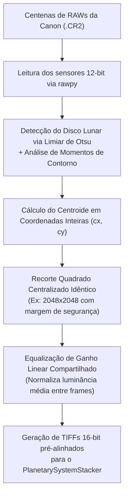

# Módulo 09: Astrofotografia Lunar — Empilhamento Autônomo (`astro_stack`)

O módulo `astro_stack` automatiza o fluxo complexo de empilhamento de imagens RAW da Lua capturadas em tripé fixo com superzoom (Canon SX60 HS a 1365mm), eliminando completamente o alinhamento manual em ferramentas legadas.

---

## 1. O Desafio da Astrofotografia Lunar com Tripé Fixo

Quando se fotografa a Lua com zoom óptico extremo de 65x (1365mm equivalente) sem montagem equatorial motorizada:
1. **Deriva da Terra (Drift):** A rotação da Terra faz a Lua se mover rapidamente através do sensor da câmera a cada disparo. Em 20 minutos, a Lua percorre toda a diagonal do enquadramento.
2. **Turbulência Atmosférica (*Seeing*):** As correntes de ar térmicas na atmosfera distorcem partes locais da imagem (efeito de "ondulação de piscina"), exigindo alinhamento multiponto por superfície (*Surface Stacking*).
3. **Flutuação de Exposição:** Nuvens finas e variações de sensibilidade geram saltos de brilho entre os frames brutos.

---

## 2. O Pré-Processador de Disco Lunar (`preprocessor.py`)

Antes de submeter os frames ao empilhador, o IRIS executa um algoritmo matemático próprio em OpenCV/NumPy para estabilizar e normalizar o disco lunar:



### Por que Coordenadas Inteiras?
Muitos algoritmos de alinhamento aplicam interpolação bilinear subpixel durante o corte preliminar, o que borra as crateras e reduz a relação sinal-ruído. O pré-processador do IRIS calcula rigorosamente o centro de massa e executa o corte em **coordenadas de inteiros rígidos**, preservando a nitidez nativa dos pixels brutos do sensor.

---

## 3. Empilhamento com PlanetarySystemStacker Headless (`worker.py`)

O IRIS utiliza o motor científico do **PlanetarySystemStacker (PSS)**, modificado com patches para operação autônoma sem interface gráfica:
- **Modo Surface:** Mapeia uma malha de centenas de caixas de alinhamento (*alignment boxes*, padrão de 64x64 pixels com busca de 20 pixels) sobre os mares e crateras lunares.
- **Avaliação de Qualidade:** Cada caixa local é avaliada individualmente em relação ao gradiente de contraste e turbulência atmosférica.
- **Descarte Seletivo por Porcentagens:** O PSS seleciona os melhores frames e gera imagens empilhadas em múltiplos patamares configurados em `modules.astro_stack.keep_percents`:
  - `10%`: Apenas o percentil de ouro dos disparos mais nítidos (máximo detalhe fino).
  - `25%`: Equilíbrio padrão entre nitidez e redução de ruído.
  - `50%`: Máxima redução de ruído (ideal para relevos iluminados).

---

## 4. Saída Padronizada e Tabela `astro_stacks`

Os arquivos finais são salvos em formato **TIFF de 16-bit não compactado** na pasta `8_Astro_Stack/YYYY/MM/DD/`:
```text
2026-10-14_CANON_SX60HS_1365mm_stacked_p10.tif
2026-10-14_CANON_SX60HS_1365mm_stacked_p25.tif
2026-10-14_CANON_SX60HS_1365mm_stacked_p50.tif
```

O registro de auditoria é gravado no banco de dados do projeto:

```sql
INSERT INTO astro_stacks (
    project_name,
    session_dir,
    raw_count,
    keep_percents,
    output_dir,
    output_tiff_paths_json,
    status
) VALUES (?, ?, ?, '[10, 25, 50]', ?, ?, 'stacked');
```
Em seguida, o pipeline encadeia automaticamente os arquivos resultantes para o motor de wavelets (`AstroSharpenStage`).
