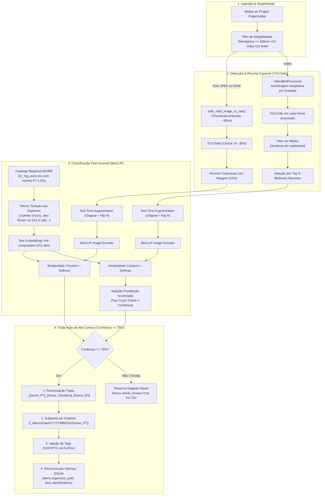

# Módulo 12: Identificação Taxonômica de Aves (`bird_id`)

O estágio de Identificação Taxonômica de Aves (`BirdIdStage` / `src.modules.bird_id`) é responsável pela triagem, detecção de presença e classificação taxonômica fine-grained de fauna ornitológica em fotografias superzoom (teleobjetivas $\ge 300\text{mm}$, como a Canon PowerShot SX60 HS de até $1365\text{mm}$) e clipes de vídeo capturados em campo.

---

## 1. Arquitetura Desacoplada em Duas Etapas (Two-Stage Pipeline)

Diferente de classificadores monolíticos convencionais que falham quando o animal ocupa uma fração reduzida do enquadramento, o IRIS adota uma arquitetura em 2 etapas com condicionamento geográfico:

---

## 2. Tripla Ação Simultânea de Alta Certeza

Quando uma ave é identificada com confiança superior ao limiar configurado (`min_species_confidence`, padrão: $75\%$), o módulo executa automaticamente:

### 2.1. Renomeação Tripla sem Perda de Metadados
O nome original higienizado (contendo data, hora, câmera, zoom, abertura, velocidade e ISO) recebe o sufixo taxonômico padronizado:
- **Fotos**:
  `2026-09-06_15-10-00_Canon-SX60_16MP_4000x3000_1365mm_f6.5_1-500s_ISO100_[Bem-te-vi]_[Pitangus-sulphuratus]_[Great-Kiskadee]_IMG_1234.JPG`
- **Vídeos**:
  `2026-09-06_15-12-00_Canon-SX60_4K_3840x2160_60fps_00-45_[Bem-te-vi]_[Pitangus-sulphuratus]_[Great-Kiskadee]_MVI_1235.MP4`

### 2.2. Separação em Subpastas por Nome Popular
O arquivo é movido para uma subpasta correspondente ao nome popular da ave em português **dentro** da categoria organizada:
- Fotos Avulsas / Rajadas: `2_AlbunsDatas/YYYY/MM/DD/{Nome_Popular_PT}/`
- Vídeos: `3_Videos/YYYY/MM/DD/{Nome_Popular_PT}/`

Dessa forma, a organização cronológica e a separação de mídias permanecem 100% preservadas, sem colisão de caminhos.

### 2.3. Injeção de Metadados EXIF/IPTC/XMP
Sem re-codificar pixels, o `exiftool` injeta:
- `Keywords` / `Subject`: `Aves`, `{Nome Popular PT}`, `{Nome Popular EN}`, `{Nome Científico}`, `{Família}`, `{Ordem}`
- `HierarchicalSubject`: `Fauna|Aves|{Família}|{Nome Científico}|{Nome Popular PT}`
- `Caption-Abstract` / `Description`: `{Nome Popular PT} ({Nome Científico}) - {Nome Popular EN}`

### 2.4. Sincronização Atômica no SQLite
O `item.organized_path`, `item.relative_dest_dir` e `item.target_filename` são atualizados no banco de dados do projeto na mesma transação. Estágios subsequentes do pipeline (como edição e upscale de vídeos 4K, publicação no YouTube ou verificação de limpeza) encontram os arquivos imediatamente.

---

## 3. Amostragem Adaptativa de Vídeo

Vídeos de aves apresentam trepidação e momentos de voo rápido (*motion blur*). Para maximizar a precisão com eficiência:
- **Amostragem Proporcional à Duração**: Em vez de passos rígidos de tempo, calcula o intervalo baseado em `video_target_frames` (padrão: 15 frames distribuídos igualmente ao longo do clipe):
  $$\Delta t = \max\left(0.5\text{s}, \min\left(5.0\text{s}, \frac{\text{Duração}}{\text{Alvo de Frames}}\right)\right)$$
- **Métrica de Nitidez (Variância do Laplaciano)**:
  $$S = \text{Var}(\nabla^2 I) \times \text{conf}_{\text{YOLO}} \times \sqrt{\text{Área}}$$
- **Validação por Consistência (`video_min_confident_crops`)**: Exige um número mínimo de recortes nítidos da mesma espécie (padrão: 3) confirmando a espécie predominante para homologar o vídeo.

---

## 4. Suporte Ultrarrápido a Fotos RAW (`.CR2`, `.ARW`, etc.)

Usuários de superzooms e DSLRs/Mirrorless costumam fotografar fauna em formato RAW. 
Em vez do demosaicing completo (que levaria ~1.500ms por foto), o leitor `safe_read_image_or_raw()` utiliza `rawpy.extract_thumb()`, extraindo o preview JPEG embutido na imagem RAW diretamente na memória em **~30ms**, conferindo à classificação de RAWs a mesma velocidade de processamento de fotos JPEG.

---

## 5. Parâmetros de Configuração (`config.yaml`)

| Parâmetro | Tipo | Padrão | Descrição |
| :--- | :---: | :---: | :--- |
| `modules.bird_id.enabled` | bool | `true` | Ativa ou desativa a etapa de identificação de aves. |
| `modules.bird_id.min_species_confidence` | float | `0.75` | Limiar mínimo de confiança para renomeação e subpasta ($75\%$). |
| `modules.bird_id.rename_files` | bool | `true` | Renomeia o arquivo físico com `[PT]_[Cientifico]_[EN]`. |
| `modules.bird_id.organize_in_subfolders` | bool | `true` | Move o arquivo para `{Nome_Popular_PT}/` dentro da categoria. |
| `modules.bird_id.write_exif_tags` | bool | `true` | Injeta palavras-chave IPTC/EXIF/XMP via ExifTool. |
| `modules.bird_id.video_target_frames` | int | `15` | Alvo de frames amostrados proporcionalmente à duração. |
| `modules.bird_id.video_min_confident_crops` | int | `3` | Mínimo de recortes com a mesma espécie para consolidar vídeo. |
| `modules.bird_id.zoom_threshold_mm` | float | `300.0` | Distância focal equivalente mínima para filtrar teleobjetivas. |
| `modules.bird_id.save_crops` | bool | `true` | Salva recortes de depuração em `recortes_aves/`. |
| `modules.bird_id.yolo_model` | str | `yolov8s.pt` | Modelo YOLOv8 utilizado (`yolov8n.pt`, `yolov8s.pt`, etc.). |
| `modules.bird_id.yolo_confidence` | float | `0.25` | Limiar mínimo de confiança para caixas delimitadoras YOLO. |

Todos os parâmetros podem ser ajustados interativamente através da opção `8. 🦜 Identificação de Aves` no menu global de configurações (`python iris/main.py -> C`).

---

## 6. Relatórios de Conferência & Auditoria

Ao concluir o processamento, o módulo gera:
- **`relatorio_aves.csv`**: Arquivo CSV no diretório do projeto contendo caminho, espécie PT/EN/Científica, confiança, top 2, top 3, caminho do recorte e flag `needs_review`.
- **Tabela Rich no Console**: Apresentação colorida resumida com destaque em vermelho para casos com `needs_review=True` e amarelo para confiança $< 75\%$.
- **Banco SQLite**: Registros persistidos na tabela `bird_identifications` nos esquemas local e central (RFC 08/09).
