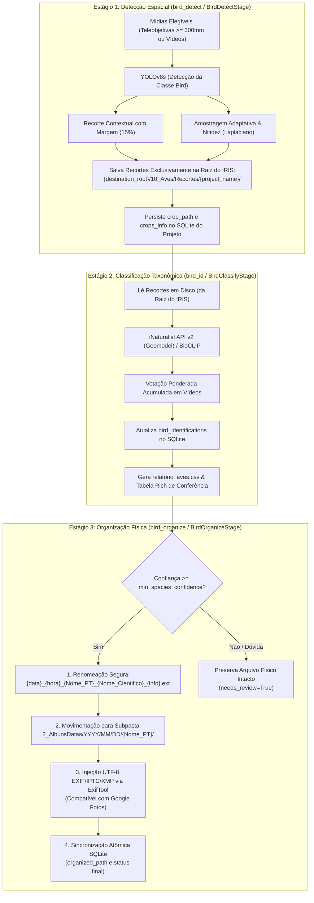

# Módulo 12: Identificação Taxonômica de Aves (`bird_id`)

O módulo de Identificação Taxonômica de Aves (`src.modules.bird_id`) é estruturado em **três etapas atômicas e sequenciais** no pipeline do IRIS, permitindo máxima transparência, auditoria intermediária e desacoplamento total entre detecção espacial, inferência taxonômica e manipulação de arquivos físicos.

---

## 1. Arquitetura Modular em Três Estágios Atômicos

---

## 2. Detalhamento dos Três Estágios

### 2.1. Estágio 1: `bird_detect` (`BirdDetectStage`)
- **Objetivo**: Detectar pássaros, extrair caixas delimitadoras e persistir recortes de alta qualidade.
- **Local dos Recortes**: Salvos **exclusivamente na raiz do IRIS** em `{destination_root}/{iris_crops_folder}/{project_name}/` (padrão: `10_Aves/Recortes/{project_name}/`). Nenhuma cópia duplicada é mantida na pasta interna de metadados do projeto.
- **Persistência no SQLite**:
  - Para cada mídia com detecção, cria um registro na tabela `bird_identifications` contendo o caminho absoluto do recorte (`crop_path`) e métricas do bounding box.
  - Para vídeos, armazena no campo `metadata_json` o dicionário `video_crops` com a lista de todos os recortes extraídos (índice do frame, timestamp, nitidez Laplaciana e caminho do recorte em disco).

### 2.2. Estágio 2: `bird_id` (`BirdClassifyStage`)
- **Objetivo**: Identificar a espécie taxonômica sem mover nem renomear nenhum arquivo físico.
- **Entrada**: Lê os recortes salvos na raiz do IRIS referenciados no banco SQLite ou no disco.
- **Motores Taxonômicos**:
  - **iNaturalist Computer Vision API v2**: Utiliza coordenadas GPS extraídas dos metadados da imagem/vídeo para condicionamento geográfico (*geomodel*), obtendo precisão em escala regional.
  - **BioCLIP (Zero-Shot)**: Fallback local robusto via embeddings textuais de catálogo regional (`br_mg_aves.csv`).
- **Vídeos**: Realiza votação ponderada acumulada entre os múltiplos frames extraídos pelo estágio 1.
- **Rajadas de Fotos (Amostragem Seletiva e Early Exit)**:
  - **Ranquamento por Nitidez**: Recortes da rajada (`burst_id`) são previamente ordenados decrescentemente pelo score composto de qualidade visual:
    $$S = \text{Var}(\nabla^2 I) \times \text{conf}_{\text{YOLO}}$$
  - **Parada Antecipada (Early Exit)**: Consulta sequencialmente apenas as principais amostras da rajada. Assim que um número configurável de fotos ($K$, padrão: 3) confirmar com alta confiança a mesma espécie, as consultas restantes à API para aquela rajada são interrompidas.
  - **Propagação Consensual**: A espécie consensual é propagada para todas as fotos da rajada (avaliadas e dispensadas), garantindo redução de até $90\%$ no tempo de requisições de rede.
- **Auditoria**: Atualiza os registros no SQLite com dados taxonômicos completos (`species_sci`, `species_pt`, `species_en`, `family`, `order`, `confidence`, `needs_review`) e gera o relatório `relatorio_aves.csv` no diretório do projeto.

### 2.3. Estágio 3: `bird_organize` (`BirdOrganizeStage`)
- **Objetivo**: Aplicar modificações estruturais no disco apenas para detecções que superem o limiar de confiança (`min_species_confidence`, padrão: 75%).
- **Hierarquia de Pastas**:
  - **Identificadas com Alta Certeza**: Em uma determinada data (`2_AlbunsDatas/YYYY/MM/DD/`), cria a pasta principal da espécie `{Nome_PT}/`.
    - **Rajadas**: Todas as rajadas daquela espécie naquele dia são agrupadas dentro da pasta da espécie:
      `2_AlbunsDatas/YYYY/MM/DD/{Nome_PT}/rajada_HH-MM-SS/`
    - **Fotos Avulsas**: Fotos avulsas identificadas ficam diretamente na pasta da espécie:
      `2_AlbunsDatas/YYYY/MM/DD/{Nome_PT}/IMG_1234_[Nome_PT]_[Cientifico]_[Nome_EN].JPG`
    - **Vídeos**: Organizados em `3_Videos/YYYY/MM/DD/{Nome_PT}/video.mp4`.
    - **Limpeza Defensiva**: Pastas de rajadas antigas na raiz da data que ficaram vazias após a movimentação são removidas com segurança.
  - **Mídias Não Identificadas**: Casos de dúvida (`needs_review=True`), confiança abaixo do limiar ou não-aves permanecem intactos na pasta do dia, **fora da pasta da espécie**:
    `2_AlbunsDatas/YYYY/MM/DD/rajada_16-00-00/` (rajada não identificada)
    `2_AlbunsDatas/YYYY/MM/DD/IMG_5678.JPG` (foto avulsa não identificada)
- **Ações Físicas**:
  1. **Renomeação Taxonômica Segura**: Posiciona o nome popular em português e o científico logo após a data e hora do disparo e antes das informações técnicas e nome original:
     `{data}_{hora}_{Nome_PT}_{Nome_Cientifico}_{camera}_{resolucao}_{lente}_{exposicao}_{ISO}_{original}.{ext}`
     *Exemplo:* `2026-09-06_15-10-00_Bem-te-vi_Pitangus-sulphuratus_Canon-SX60_16MP_4608x3456_247mm_f-6.5_1-250s_ISO400_IMG_1234.JPG`
     (As fotos irmãs da mesma rajada também são renomeadas de forma consistente).
  2. **Subpasta por Espécie**: Move a mídia para a subpasta com o nome em português dentro da sua categoria cronológica (`2_AlbunsDatas/YYYY/MM/DD/{Nome_PT}/` ou `3_Videos/.../{Nome_PT}/`).
  3. **Tags EXIF/IPTC/XMP UTF-8**: Injeta metadados taxonômicos (Description, Caption, Keywords, Subject, HierarchicalSubject, Title, XPTitle, XPComment, XPKeywords) via *argfile* UTF-8 do `exiftool`, preservando 100% dos acentos e espaços sem corrupção no Google Fotos, Apple Fotos, Windows Explorer e Lightroom.
  4. **Sincronização SQLite**: Atualiza `items.organized_path` e o caminho correspondente em `bird_identifications` atomicamente.

---

## 3. Amostragem e Extração de Vídeos

- **Amostragem Adaptativa**: Extrai frames distribuídos de acordo com a duração do clipe.
- **Seleção por Nitidez**: Avalia o foco via Variância do Laplaciano ponderada pelo score do YOLO:
  $$S = \text{Var}(\nabla^2 I) \times \text{conf}_{\text{YOLO}} \times \sqrt{\text{Área}}$$
- **Limite Configurável (`video_max_crops`)**: Determina a quantidade máxima de melhores recortes salvos e enviados para classificação taxonômica (padrão: 5 recortes por vídeo).

---

## 4. Parâmetros de Configuração (`config.yaml`)

| Parâmetro | Tipo | Padrão | Descrição |
| :--- | :---: | :---: | :--- |
| `modules.bird_id.enabled` | bool | `true` | Habilita os estágios de identificação de aves. |
| `modules.bird_id.iris_crops_folder` | str | `10_Aves/Recortes` | Pasta de destino dos recortes na raiz do IRIS. |
| `modules.bird_id.video_max_crops` | int | `5` | Máximo de recortes mais nítidos extraídos por vídeo. |
| `modules.bird_id.video_target_frames` | int | `15` | Frames amostrados proporcionalmente à duração do clipe. |
| `modules.bird_id.min_species_confidence` | float | `0.75` | Limiar mínimo de confiança para organização e renomeação ($75\%$). |
| `modules.bird_id.rename_files` | bool | `true` | Habilita renomeação física no estágio de organização. |
| `modules.bird_id.organize_in_subfolders` | bool | `true` | Habilita separação em subpastas `{Nome_PT}/`. |
| `modules.bird_id.write_exif_tags` | bool | `true` | Injeta metadados IPTC/EXIF via ExifTool. |
| `modules.bird_id.zoom_threshold_mm` | float | `300.0` | Distância focal equivalente mínima para teleobjetivas. |
| `modules.bird_id.yolo_model` | str | `yolov8s.pt` | Modelo YOLOv8 utilizado (`yolov8s.pt`, etc.). |
| `modules.bird_id.yolo_confidence` | float | `0.25` | Limiar mínimo de confiança do detector YOLO. |
| `modules.bird_id.enable_burst_consensus` | bool | `true` | Ativa consolidação consensual de espécies por rajada fotográfica. |
| `modules.bird_id.burst_min_agreement_ratio` | float | `0.50` | Razão mínima de concordância entre os membros da rajada ($50\%$). |
| `modules.bird_id.enable_burst_early_exit` | bool | `true` | Habilita parada antecipada na classificação após quorum de confirmações. |
| `modules.bird_id.burst_early_exit_confirmations` | int | `3` | Número de confirmações de alta confiança para disparar o early exit. |

Todos os parâmetros podem ser ajustados interativamente através da opção `8. 🦜 Identificação de Aves` no menu global de configurações (`python iris/main.py -> C`).

---

## 5. Auditoria e Relatórios

- **`relatorio_aves.csv`**: Gerado na pasta do projeto ao final da classificação, contendo caminho original, nomes taxonômicos, métricas de confiança, caminho do recorte e status de revisão.
- **Tabela Rich Interativa**: Resumo no terminal colorido destacando espécies com alta certeza em verde e casos pendentes de revisão em amarelo/vermelho.
- **Rastreabilidade no SQLite**: Todas as mídias mantêm vínculo direto com a localização exata do recorte armazenado em disco na raiz do IRIS.
