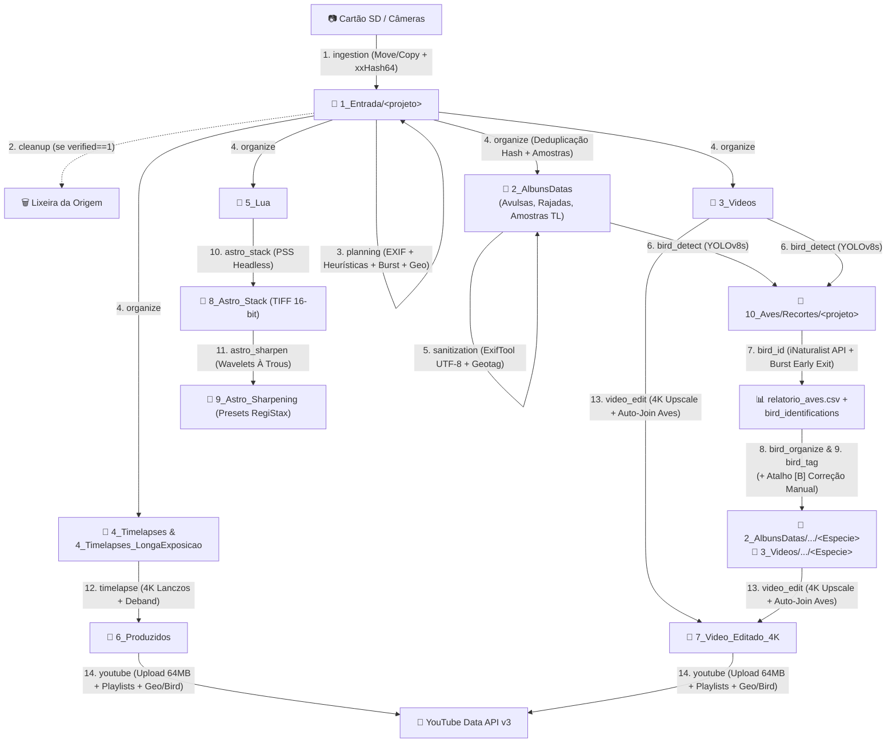

# Referência Técnica: Matriz Mestre & Ciclo de Vida do Pipeline

Esta página é o **mapa mental definitivo** de como as 13 etapas do pipeline e os fluxos interativos do IRIS se conectam com os módulos Python, tabelas SQLite e pastas de destino no SSD (`C:\IRIS`).

---

## 1. Matriz Mestre do Pipeline (13 Etapas Sequenciais)

Abaixo está o mapeamento exato na ordem de execução configurada em `pipeline.stages`:

| # | ID da Etapa | Nome na CLI | Módulo Python (`get_stage`) | Tabelas SQLite (Leitura $\rightarrow$ Escrita) | Pastas em `C:\IRIS` (Origem $\rightarrow$ Destino) |
| :-: | :--- | :--- | :--- | :--- | :--- |
| **1** | `ingestion` | Ingestão de Arquivos (SD -> SSD) | `src.modules.ingestion.stage` | $\rightarrow$ `items` (`status='copied'`, `verified=1`) | Cartão SD/HD $\rightarrow$ `1_Entrada/<projeto>/` |
| **2** | `cleanup` | Limpeza da Origem (Após verificação) | `src.modules.cleanup.stage` | `items` (`verified==1`) | Remove da mídia de origem (Lixeira / Hash-Guarded) |
| **3** | `planning` | Planejamento e Metadados (Staging) | `src.modules.planning.stage` | `items` $\rightarrow$ `items` (`meta_*`, `category`, `burst_id`, `target_filename`) | Lê `1_Entrada/<projeto>/` (sem mover arquivos) |
| **4** | `organize` | Organização Física (SSD) | `src.modules.organize.stage` | `items` $\rightarrow$ `items` (`status='organized'`, `organized_path`) | `1_Entrada/<projeto>/` $\rightarrow$ `2_AlbunsDatas/`, `3_Videos/`, `4_Timelapses/`, `4_Timelapses_LongaExposicao/`, `5_Lua/` |
| **5** | `sanitization` | Sanitização de Metadados e Geotag (Álbuns) | `src.modules.sanitization.stage` | `items`, `projects.geo_location_id` $\rightarrow$ `items` (`file_hash`, `geo_written`) | Aplica ExifTool UTF-8 apenas em fotos de `2_AlbunsDatas/` (preserva RAWs/vídeos/timelapses intactos) |
| **6** | `bird_detect` | Detecção e Recorte de Aves (YOLOv8) | `src.modules.bird_id.detect_stage` | `items` $\rightarrow$ `bird_identifications` (`crop_saved_path`, `metadata_json`) | Lê `2_AlbunsDatas/` e `3_Videos/` $\rightarrow$ Salva recortes em `10_Aves/Recortes/<projeto>/` |
| **7** | `bird_id` | Classificação Taxonômica de Aves (iNaturalist) | `src.modules.bird_id.classify_stage` | `bird_identifications` $\rightarrow$ `bird_identifications`, `species_catalog` | Consome recortes em `10_Aves/Recortes/<projeto>/` $\rightarrow$ Gera `relatorio_aves.csv` |
| **8** | `bird_organize` | Organização Física de Aves (Subpastas e Nomes) | `src.modules.bird_id.organize_stage` | `bird_identifications`, `items` $\rightarrow$ `items`, `bird_identifications` | Move/renomeia em `2_AlbunsDatas/YYYY/MM/DD/<Ave>/` e `3_Videos/YYYY/MM/DD/<Ave>/` |
| **9** | `bird_tag` | Injeção de Metadados de Aves (EXIF/IPTC) | `src.modules.bird_id.tag_stage` | `bird_identifications`, `items` $\rightarrow$ Tags EXIF/IPTC/XMP UTF-8 | Atualiza metadados nas fotos organizadas em `2_AlbunsDatas/` |
| **10** | `astro_stack` | Empilhamento Lunar (PSS -> 8_Astro_Stack) | `src.modules.astro_stack.stage` | `items` (`category='lua'`) $\rightarrow$ `astro_stacks` (Dual-Write) | `5_Lua/` $\rightarrow$ `8_Astro_Stack/Lua/YYYY/MM/DD/` (TIFF 16-bit) |
| **11** | `astro_sharpen` | Aprimoramento Wavelets (9_Astro_Sharpening) | `src.modules.astro_sharpen.stage` | `astro_stacks` $\rightarrow$ `astro_sharpens` (Dual-Write) | `8_Astro_Stack/` $\rightarrow$ `9_Astro_Sharpening/Lua/YYYY/MM/DD/` (TIFF 16-bit + PNG) |
| **12** | `timelapse` | Renderização de Timelapse 4K | `src.modules.timelapse.stage` | `items` (`timelapse*`) $\rightarrow$ `timelapses` (Dual-Write) | `4_Timelapses/` e `4_Timelapses_LongaExposicao/` $\rightarrow$ `6_Produzidos/` (`.mp4` 4K) |
| **13** | `video_edit` | Edição e Upscale de Vídeo 4K | `src.modules.video_edit.stage` | `items` (`video`), `bird_identifications` $\rightarrow$ `edited_videos` (Dual-Write) | `3_Videos/` $\rightarrow$ `7_Video_Editado_4K/` (`.mp4` 4K individual ou joined por ave/dia) |
| **14** | `youtube` | Publicação de Vídeos no YouTube | `src.modules.youtube.stage` | `timelapses`, `edited_videos`, `bird_identifications` $\rightarrow$ Atualiza `youtube_video_id`, `local_file_deleted` | Publica de `6_Produzidos/` e `7_Video_Editado_4K/` na YouTube Data API v3 (chunks de 64MB) |

> [!NOTE]
> ### Fluxos Interativos Transversais na CLI (`main.py`)
> - **Atalho `[B]` — Revisão / Correção Taxonômica de Aves (`src.modules.bird_id.correction`)**: Permite revisar itens com `needs_review=1` (ou qualquer ave do projeto), escolher entre Top 2/3 da IA, buscar no catálogo global (`species_catalog`), propagar para rajadas/sessões contíguas, renomear/mover arquivos já organizados e regravar EXIF/IPTC + `relatorio_aves.csv`.
> - **Atalho `[G]` — Geolocalização do Projeto (`src.core.geo.GeoService`)**: Associa um local predefinido (`projects.geo_location_id`) com geocodificação reversa (Nominatim / BigDataCloud), aplicando token `{gps}` nos nomes, prior geográfico no iNaturalist e blocos de habitat/playlists municipais no YouTube.
> - **Atalho `[C]` / `[S]` — Hub de Configurações (`src.core.config_menu` + `src.core.config_menus/*`)**: 9 subpáginas temáticas que editam `~/.iris/config.yaml` com auto-migração e sanitização UTF-8.

---

## 2. Diagrama de Fluxo de Dados e Pastas (`C:\IRIS`)

---

## 3. Máquina de Estados dos Itens (`items.status`)

Cada arquivo ingerido no banco do projeto (`<projeto>.db`) transita pelos estados da coluna `status` na tabela `items`:

| Estado (`status`) | Significado | Etapa Responsável |
| :--- | :--- | :--- |
| `pending` | Arquivo mapeado antes da conclusão da cópia/movimentação. | Inicialização |
| `copied` | Arquivo copiado/movido para `1_Entrada/<projeto>/` com `verified = 1` (hash `xxHash64` validado). | `1. ingestion` |
| `planned` | Metadados EXIF/ópticos extraídos, categoria atribuída (`fotos_avulsas`, `videos`, `timelapse`, `timelapse_long_exposure`, `lua`), `burst_id` calculado e `target_filename` gerado. | `3. planning` |
| `organized` | Arquivo movido fisicamente para a pasta definitiva em `C:\IRIS` (ou deduplicado por hash contra arquivo idêntico já existente) com `organized_path` preenchido. | `4. organize` (atualizado por `5. sanitization`, `8. bird_organize` e `B. bird_correction`) |
| `error` | Falha de leitura/hash durante a ingestão (bloqueia qualquer limpeza da origem pelo princípio Zero Data Loss). | `1. ingestion` |

---

## 4. Tratamento de Exceções, Concorrência e Retomabilidade

1. **Bloqueio Atômico (`ProjectLock`)**: Ao abrir um projeto, o IRIS cria atomicamente `projects/<projeto>.lock` via `os.O_CREAT | os.O_EXCL` com PID, hostname e heartbeat. Múltiplos terminais podem processar projetos *diferentes* em paralelo sem colisão.
2. **Transações SQLite com `SAVEPOINT`**: Operações em lote utilizam `with project.transaction():` com conexões isoladas por thread (`threading.local`) e suporte a transações aninhadas.
3. **Poda Contínua de Pastas Vazias (`src.core.cleanup.clean_empty_directories`)**: Ao final de cada etapa (como esvaziamento de `1_Entrada`, reorganização de rajadas/aves ou limpeza pós-YouTube), diretórios vazios residuais são removidos de baixo para cima preservando a raiz `C:\IRIS`.
