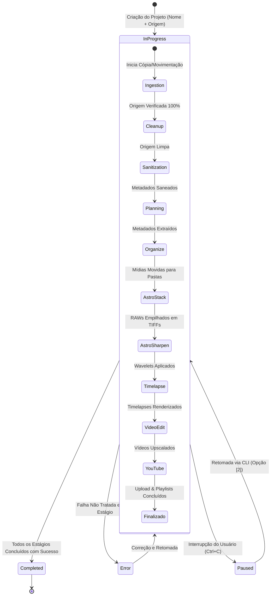

# Referência Técnica: Ciclo de Vida do Pipeline & Máquina de Estados

Esta página descreve as transições de estado pelas quais um projeto e seus arquivos transitam desde a inserção do cartão de memória até a publicação no YouTube e arquivamento definitivo.

---

## 1. Máquina de Estados do Projeto

Um projeto do IRIS possui um ciclo de vida governado pela coluna `status` no banco central e pelo ponteiro `current_stage_id`:

---

## 2. Máquina de Estados dos Arquivos (`files`)

Cada item individual transita por estados bem definidos na coluna `status` da tabela `files`:

| Estado | Significado | Condição de Transição |
| :--- | :--- | :--- |
| `pending` | Arquivo detectado na varredura inicial da origem. | Início do estágio de ingestão. |
| `ingested` | Arquivo copiado ou movido para o staging com `verified = 1`. | Hashes `xxh64` de origem e destino validados. |
| `sanitized` | Metadados EXIF/APP2/MakerNotes saneados para Google Fotos. | ExifTool executado com sucesso e novo hash recalculado. |
| `planned` | Metadados ópticos extraídos e categoria preditiva atribuída. | Conclusão do `PlanningStage`. |
| `organized`| Arquivo movido fisicamente para a pasta definitiva com nome rico. | Conclusão do `OrganizeStage`. |

---

## 3. Tratamento de Exceções e Retomabilidade

Se o usuário pressionar `Ctrl+C` ou ocorrer uma queda de energia no meio do processamento de um timelapse de 2.000 fotos:
1. O manipulador de sinal captura o `KeyboardInterrupt`.
2. As conexões SQLite disparam `commit` das transações atômicas pendentes.
3. O `ProjectLock` registra o evento e libera os handles de arquivo.
4. Ao reabrir a CLI e escolher *"Retomar Projeto"*, o IRIS lê `current_stage_id` e a tabela `files`, identificando quais fotos já foram processadas e continuando o trabalho **exatamente de onde parou**, sem refazer operações que já foram validadas.
