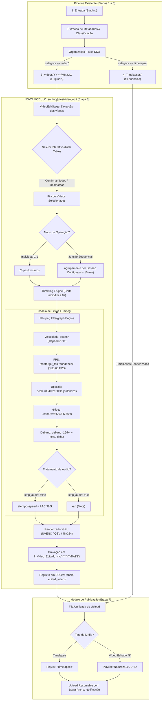

# Especificação Técnica e Plano Detalhado: Módulo de Edição e Upscale de Vídeos 4K UHD (`video_edit`)

---

## 1. Contexto e Motivação Técnica

### 1.1 O Ecossistema IRIS
O **IRIS (Integrated Recording and Ingestion System)** gerencia de ponta a ponta o ciclo de vida de mídias de fotografia e filmagem da natureza (capturadas com Canon PowerShot SX60 HS, GoPro Hero 5 Black, Canon T6, smartphones e câmeras com CHDK).

O sistema já possui um motor maduro e autônomo para **Timelapses** (Etapa 5) com renderização 4K Lanczos e publicação automática no YouTube com ficha técnica detalhada. Contudo, os **vídeos convencionais** gravados em campo (pássaros em superzoom, animais, paisagens ou eventos) atualmente apenas são movidos fisicamente para a pasta `3_Videos/YYYY/MM/DD/` sem receber tratamento de masterização, upscale, corte de tremido ou envio automatizado para o canal.

### 1.2 O Problema da Compressão do YouTube em Vídeos 1080p
Quando um vídeo gravado em resolução nativa 1080p (Full HD) é enviado diretamente ao YouTube:
1. O YouTube atribui por padrão o codec **AVC1 (H.264)** com bitrate muito baixo (~8 Mbps para 1080p).
2. O algoritmo do YouTube comprime agressivamente detalhes de alta frequência (folhagens, textura de penas de aves em superzoom, ondulações de água e céus).
3. Gradientes suaves de cor (como o céu em amanheceres ou crepúsculos) sofrem de severo **color banding** (faixas visíveis de degradação de cor de 8 bits).

### 1.3 A Solução de Engenharia
Ao realizar o **upscale de alta fidelidade para 4K UHD (3840x2160)** antes do envio:
- O YouTube é forçado a transcodificar o vídeo utilizando os decodificadores premium **VP09 (profile 0/2)** ou **AV01 (av01.0.08M.08)**, concedendo bitrates significativamente superiores (até 40–60 Mbps em 4K).
- A aplicação combinada de **escala Lanczos**, realce seletivo de bordas (**Unsharp Mask**) e filtro **Deband 16-bit com micro-dither** garante que os gradientes sejam preservados intactos, resultando em qualidade visual cristalina no canal.

---

## 2. Diagrama de Arquitetura do Pipeline



---

## 3. Especificação das Novas Funcionalidades e Regras de Negócio

### 3.1 Seleção de Vídeos e Comportamento Interativo
1. **Varredura Automática:** O módulo identifica no banco do projeto todos os itens com `category == "video"`.
2. **Apresentação em Terminal (Rich):** Uma tabela dinâmica exibirá:
   - ID / Índice
   - Nome original do arquivo
   - Câmera / Modelo
   - Resolução nativa (ex: `1920x1080`) e proporção
   - FPS original (ex: `29.97`, `30`, `60`)
   - Duração original
   - Status (Pendente / Já Renderizado)
3. **Fluxo de Confirmação:**
   - **Modo Interativo (Padrão):** O sistema seleciona **todos** os vídeos por padrão. Um prompt interativo permite ao usuário pressionar `[ENTER]` para confirmar todos, ou digitar índices separados por vírgula para desmarcar (ex: `desmarcar 2,4`).
   - **Modo Batch / Não Interativo:** Quando executado via pipeline automático (`interactive: false`), todos os vídeos pendentes são processados diretamente.

---

### 3.2 Modos de Edição: Individual vs. Junção Sequencial

#### Modo A: Individual (`mode: "individual"`)
- Cada arquivo de vídeo gravado em `3_Videos/` é tratado de forma independente.
- Relação: $1 \text{ vídeo original} \rightarrow 1 \text{ vídeo 4K masterizado}$.

#### Modo B: Junção Sequencial (`mode: "joined"`)
- O objetivo é unir pequenas tomadas sequenciais (ex: pássaro pousado em galho gravado em 3 arquivos sucessivos de 20 segundos) em um único vídeo contínuo.
- **Critério de Agrupamento por Sessão Contígua:**
  1. Clipes devem pertencer à **mesma câmera** (`camera_make` + `camera_model`).
  2. Clipes são ordenados cronologicamente pelo timestamp de início (`start_timestamp`).
  3. Dois clipes consecutivos $A$ e $B$ pertencem à mesma sessão se:
     $$\Delta t = \text{timestamp}_{\text{início}}(B) - \text{timestamp}_{\text{fim}}(A) \le (\text{session\_interval\_minutes} \times 60)$$
     *(Padrão: 10 minutos, configurável).*
  4. Caso o intervalo ultrapasse 10 minutos ou a câmera mude, encerra-se a sessão atual e inicia-se uma nova.
- **Concatenação sem Degradação:**
  - O corte de início e fim (trimming) é aplicado a cada clipe antes da fusão.
  - Os clipes são concatenados pelo FFmpeg via `concat filter` ou concat demuxer com reamostragem homogênea para o FPS alvo e espaço de cor comum.

---

### 3.3 Trimming Automático de Início e Fim

#### Motivação
Em gravações manuais, os primeiros 1 a 2 segundos costumam conter o tremor do dedo pressionando o botão de gravação da câmera. Da mesma forma, os últimos segundos sofrem de instabilidade quando o usuário move a mão para encerrar a captura.

#### Parâmetros e Regras
- **Flag de ativação:** `trim_enabled: true` (padrão: ativado).
- **Tempo de corte:** `trim_seconds: 2.0` (padrão: 2.0s cortados do início e 2.0s cortados do fim).
- **Proteção Matemática de Duração Mínima:**
  - Se a duração total do vídeo $T_{\text{video}} \le (2 \times \text{trim\_seconds} + 1.0)$:
    - O trimming automático é **ignorado** ou reduzido para 0 para evitar que o clipe resultante fique vazio ou cause falha no FFmpeg.
    - O sistema emite um aviso informativo: `[yellow]Clipe muito curto ({T}s) para aplicar trim de {trim_seconds}s. Mantendo duração integral.[/yellow]`.
- **Implementação FFmpeg:**
  - `-ss {trim_seconds} -to {T_video - trim_seconds}` com busca precisa de timestamp antes do demuxer ou no início do filtergraph.

---

### 3.4 Controle Dinâmico de Velocidade (`--speed=Nx`) e Normalização de FPS

#### Parâmetro de Velocidade
- Suporte a argumento CLI e entrada no config: `--speed=2x`, `--speed=0.5x`, `--speed=1x`, etc.
- Valores float internos: `speed = 2.0` (aceleração 2x), `speed = 0.5` (câmera lenta 2x), `speed = 1.0` (velocidade normal).

#### Regra de Normalização de FPS (Teto em 60 FPS)
- **Alvo padrão:** `target_fps = 60` (configurável no `config.yaml`).
- **Aceleração (ex: `--speed=2x`):**
  - Um vídeo original de 30 FPS acelerado em 2x possui taxa efetiva de apresentação de 60 quadros/segundo reais. O filtro `fps=60` mantém todos os 60 quadros em 1 segundo de tempo real.
  - Um vídeo original de 60 FPS acelerado em 2x teria taxa teórica de 120 FPS. Para respeitar o teto de 60 FPS do YouTube e evitar artefatos de renderização, o filtro descarta 1 a cada 2 quadros (`frame drop`), mantendo o vídeo a 60 FPS com a imagem 2x mais rápida.
- **Câmera Lenta (ex: `--speed=0.5x`):**
  - Um vídeo original de 30 FPS desacelerado em 0.5x terá sua duração dobrada. O filtro duplica os quadros necessários (`frame repeat`) para preencher a cadência estável de 60 FPS no container final.
- **Filtergraph de Vídeo:**
  ```text
  setpts=(1/speed)*PTS,fps=fps=60:round=near
  ```

#### Sincronização e Tratamento de Áudio
- **Com Áudio Preservado (`strip_audio: false`):**
  - O áudio é acelerado ou desacelerado em perfeita sincronia com o vídeo através do filtro `atempo`.
  - Como o `atempo` do FFmpeg opera nativamente no intervalo $[0.5, 2.0]$, o sistema implementa uma cadeia encadeada automática para fatores extremos:
    - Para `speed = 4.0`: `atempo=2.0,atempo=2.0`.
    - Para `speed = 0.25`: `atempo=0.5,atempo=0.5`.
  - Codificação de saída: `-c:a aac -b:a 320k -ar 48000` (qualidade máxima estéreo de estúdio).
- **Com Remoção de Áudio (`strip_audio: true`):**
  - O fluxo de áudio é descartado com a flag `-an`.
  - Muito útil para gravações com vento forte em microfone embutido ou filmagens aceleradas onde o áudio não possui valor estético.

---

### 3.5 Cadeia Completa de Filtros FFmpeg (4K Lanczos + Unsharp + Deband)

```bash
# Exemplo de comando completo construído pelo módulo para um clipe 1080p @ 30fps acelerado em 2x:
ffmpeg -y -hide_banner \
  -ss 2.0 -to 28.0 -i "C:/IRIS/3_Videos/2026/08/17/2026-08-17_14-30-00_Canon-SX60_1080p_1920x1080_30fps_00m30s_MVI_0042.mp4" \
  -filter_complex "[0:v]setpts=0.5*PTS,fps=fps=60:round=near,scale=3840:2160:flags=lanczos+accurate_rnd+full_chroma_int,unsharp=luma_msize_x=5:luma_msize_y=5:luma_amount=0.8:chroma_msize_x=5:chroma_msize_y=5:chroma_amount=0.0,deband=1thr=0.04:2thr=0.04:3thr=0.04:range=16:blur=true:coupling=true[vout];[0:a]atempo=2.0[aout]" \
  -map "[vout]" -map "[aout]" \
  -c:v h264_nvenc -preset p5 -cq 16 -rc vbr \
  -pix_fmt yuv420p \
  -colorspace bt709 -color_trc bt709 -color_primaries bt709 \
  -movflags +faststart \
  -c:a aac -b:a 320k -ar 48000 \
  "C:/IRIS/7_Video_Editado_4K/2026/08/17/2026-08-17_14h30m_Canon-SX60_orig-1920x1080_to_4K-3840x2160_orig30fps_to_60fps_speed2.0x_trim2.0s_audio_00m13s_video_editado.mp4"
```

*Detecção de Hardware:* O módulo reutilizará o motor `detect_ffmpeg_encoder` já existente no IRIS, testando sucessivamente:
1. `h264_nvenc (NVIDIA)` com `-preset p5 -cq 16 -rc vbr`.
2. `h264_qsv (Intel Quick Sync)` com `-preset veryfast -global_quality 16`.
3. `h264_amf (AMD)` com `-quality speed -rc cbr`.
4. `libx264 (CPU)` com `-preset slow -crf 16` (fallback de máxima fidelidade).

---

## 4. Padrão de Nomenclatura no Disco (`7_Video_Editado_4K`)

### 4.1 Estrutura de Pastas
Os arquivos finais renderizados serão salvos rigorosamente sob:
```text
C:\IRIS\7_Video_Editado_4K\YYYY\MM\DD\<nome_do_arquivo>.mp4
```

### 4.2 Anatomia do Nome do Arquivo
O padrão de nomenclatura foi concebido para expressar **todas as variáveis técnicas do vídeo original e do processamento**:

```text
{DATA_HORA}_{CAMERA}_{CLIPES}_{RESOLUCAO}_{FPS}_{VELOCIDADE}_{TRIM}_{AUDIO}_{DURACAO}_{SUFIXO}.mp4
```

| Componente | Exemplo | Significado / Regra |
| :--- | :--- | :--- |
| `{DATA_HORA}` | `2026-08-17_14h30m` | Data e hora de início (ou `14h30m-14h55m` no modo junção) |
| `{CAMERA}` | `Canon-SX60` | Marca e modelo sanitizados |
| `{CLIPES}` | `1clipe` ou `3clipes` | Quantidade de tomadas fundidas no arquivo |
| `{RESOLUCAO}` | `orig-1920x1080_to_4K-3840x2160` | Resolução nativa de entrada e resolução final masterizada |
| `{FPS}` | `orig30fps_to_60fps` | Taxa de quadros original de captura e taxa final do container |
| `{VELOCIDADE}` | `speed2.0x` / `speed0.5x` | Multiplicador de velocidade aplicado |
| `{TRIM}` | `trim2.0s` / `trim0.0s` | Segundos aparados nas extremidades |
| `{AUDIO}` | `audio` ou `mute` | Estado do áudio (preservado ou removido) |
| `{DURACAO}` | `00m13s` / `02m45s` | Duração real final do arquivo gerado |
| `{SUFIXO}` | `video_editado.mp4` | Identificador único de arquivo produzido |

#### Exemplos Reais de Nomes Gerados (sem ponto no corpo do nome, apenas na extensão):
1. **Vídeo Individual Normal (1x, com áudio e corte de 2s):**
   `2026-08-17_14h30m_Canon-SX60_1clipe_orig-1920x1080_to_4K-3840x2160_orig30fps_to_30fps_speed1-0x_trim2-0s_audio_00m26s_video_editado.mp4`
2. **Vídeo Acelerado 2x com Teto a 60 FPS (sem áudio):**
   `2026-08-17_14h30m_Canon-SX60_1clipe_orig-1920x1080_to_4K-3840x2160_orig30fps_to_60fps_speed2-0x_trim2-0s_mute_00m13s_video_editado.mp4`
3. **Sessão Sequencial Fundida (3 clipes contíguos unidos):**
   `2026-08-17_14h30m-14h48m_Canon-SX60_3clipes_orig-1920x1080_to_4K-3840x2160_orig30fps_to_60fps_speed1-0x_trim2-0s_audio_01m45s_video_editado.mp4`

---

## 5. Modelagem do Banco de Dados SQLite

### 5.1 Tabela `edited_videos`
Criada no banco de cada projeto (`.iris/projects/<project>.db`) e replicada no banco global (`.iris/iris_central.db`):

```sql
CREATE TABLE IF NOT EXISTS edited_videos (
    id INTEGER PRIMARY KEY AUTOINCREMENT,
    project_name TEXT NOT NULL,
    source_video_paths TEXT NOT NULL,       -- JSON array de caminhos originais em 3_Videos
    output_video_path TEXT UNIQUE NOT NULL, -- Caminho absoluto final em 7_Video_Editado_4K
    mode TEXT NOT NULL,                     -- 'individual' ou 'joined'
    clip_count INTEGER DEFAULT 1,           -- Quantidade de tomadas fundidas
    speed_factor REAL DEFAULT 1.0,          -- Multiplicador (ex: 1.0, 2.0, 0.5)
    orig_fps REAL,                          -- FPS capturado pela câmera
    target_fps REAL,                        -- FPS final gravado no container
    orig_resolution TEXT,                   -- ex: '1920x1080'
    target_resolution TEXT,                 -- ex: '3840x2160'
    trim_start_sec REAL DEFAULT 0.0,
    trim_end_sec REAL DEFAULT 0.0,
    audio_stripped INTEGER DEFAULT 0,       -- 0 = áudio mantido, 1 = áudio mutado
    duration_seconds REAL,                  -- Duração do arquivo final gerado
    encoder TEXT,                           -- ex: 'h264_nvenc (NVIDIA)'
    youtube_video_id TEXT,                  -- ID do vídeo pós-upload (ex: dQw4w9WgXcQ)
    youtube_url TEXT,                       -- URL pública/unlisted do YouTube
    youtube_privacy TEXT,                   -- 'unlisted' ou 'public'
    status TEXT DEFAULT 'rendered',         -- 'rendered', 'uploaded', 'error'
    metadata_json TEXT DEFAULT '{}',        -- JSON extensível com metadados fotográficos/técnicos
    created_at TIMESTAMP DEFAULT CURRENT_TIMESTAMP,
    updated_at TIMESTAMP DEFAULT CURRENT_TIMESTAMP
);
```

---

## 6. Publicação no YouTube e Ficha Técnica

### 6.1 Playlist e Parâmetros
- **Playlist Padrão:** `"Natureza 4K UHD"` (editável no `config.yaml`).
- **Privacidade Padrão:** Segue a configuração global `modules.youtube.privacy_status` (geralmente `unlisted` ou `public`).

### 6.2 Template do Título Oficial
```text
{AAAA-MM-DD} ({HH:MM - HH:MM}) - Vídeo 4K UHD
```
*Exemplos:*
- **Sessão / Múltiplos clipes:** `2026-10-09 (16:22 - 18:35) - Vídeo 4K UHD`
- **Clipe único longo (>1 min):** `2026-10-09 (16:22 - 16:25) - Vídeo 4K UHD`
- **Clipe único curto (mesmo minuto):** `2026-10-09 (16:22) - Vídeo 4K UHD`

### 6.3 Estrutura da Ficha Técnica na Descrição

```text
Vídeo capturado e masterizado em altíssima definição 4K UHD (3840x2160) a {FPS} FPS.
Gravado em {DATA_HORA}, produzido e publicado de forma automatizada pelo IRIS (Integrated Recording and Ingestion System).

⏱️ TEMPO, CAPTURA E VELOCIDADE:
• Data e Hora de Captura: 17/08/2026 às 14:30:22
• Duração Original: 30.0 segundos
• Trimming Aplicado: 2.0s no início e 2.0s no fim (remoção de instabilidade de obturador)
• Duração Final: 13.0 segundos
• Multiplicador de Velocidade: 2.0x (Aceleração com preservação temporal)
• Taxa de Quadros (FPS): 30.0 FPS original ➔ 60.0 FPS final (Normalização para teto de 60 FPS)
• Composição da Cena: 1 clipe unitário

📷 EQUIPAMENTO E ARQUIVO ORIGINAL:
• Câmera: Canon PowerShot SX60 HS
• Resolução Nativa Original: 1920x1080 Full HD (Proporção 16:9)
• Codec Original: H.264 / MPEG-4 AVC
• Áudio Original: Estéreo AAC 48000 Hz 128 kbps (Sincronizado via atempo 2.0x)
• Armazenamento Original: 34.5 MB (Taxa de Bits: ~9.2 Mbps)

🛠️ PROCESSAMENTO E ENGENHARIA DE VÍDEO (MASTERIZAÇÃO 4K):
• Motor de Upscale: Interpolação Lanczos de Alta Fidelidade (flags=lanczos+accurate_rnd)
• Realce de Textura: Unsharp Mask adaptativo (luma amount: 0.8)
• Mitigação de Banding: Filtro Deband 16-bit com micro-dither temporal (calibrado para mitigar color banding na compressão VP09/AV01 do YouTube)
• Acelerador de Codificação: h264_nvenc (NVIDIA GPU Hardware Acceleration)
• Tempo de Renderização: 8.2 segundos (média de 95.1 FPS de codificação)
• Tamanho do Vídeo Master: 62.4 MB (Bitrate Médio: ~38.4 Mbps)

📁 RASTREABILIDADE IRIS:
• Projeto: 2026-08-17_Sessao_Natureza
• Arquivo Gerado: 2026-08-17_14h30m_Canon-SX60_1clipe_orig-1920x1080_to_4K-3840x2160_orig30fps_to_60fps_speed2.0x_trim2.0s_audio_00m13s_video_editado.mp4
• Caminho de Origem: 3_Videos/2026/08/17/2026-08-17_14-30-00_Canon-SX60_1080p_1920x1080_30fps_00m30s_MVI_0042.mp4
• Pipeline: IRIS v2.0 - Video Mastering Stage
```

---

## 7. Configurações Globais e Painel Interativo (`main.py`)

### 7.1 Bloco no `config.yaml`
```yaml
modules:
  video_edit:
    enabled: true
    mode: individual                  # 'individual' ou 'joined'
    session_interval_minutes: 10.0    # Tolerância máxima entre clipes para formar sessão
    trim_enabled: true                # Ativa o corte de início e fim
    trim_seconds: 2.0                 # Quantidade de segundos a cortar nas pontas
    strip_audio: false                # Se true, remove o áudio (-an); se false, preserva com atempo
    speed: 1.0                        # Fator de velocidade padrão (1.0 = normal, 2.0 = 2x, 0.5 = lento)
    target_fps: 60                    # FPS alvo final (limite de 60fps)
    target_width: 3840                # Resolução horizontal 4K
    target_height: 2160               # Resolução vertical 4K
    crf: 16                           # Fator de qualidade visual (16 = altíssima fidelidade)
    preset: slow                      # Preset de codificação
    unsharp_filter: true              # Ativa nitidez adaptativa pós-upscale
    deband_enabled: true              # Ativa deband 16-bit contra color banding
  youtube:
    video_playlist: "Natureza 4K UHD" # Playlist oficial para vídeos editados
```

### 7.2 Novas Opções no Submenu de Configurações (`iris/main.py`)
No menu interativo `Configurações Globais - Iris` (opção `C`), serão adicionadas as linhas:
- `23`: **Modo Edição Vídeo** (`Individual` / `Junção de Sessão`)
- `24`: **Velocidade Padrão Vídeo** (`1.0x`, `2.0x`, `0.5x`)
- `25`: **FPS Alvo Saída** (`60 FPS`)
- `26`: **Trimming Início/Fim (s)** (`2.0s`)
- `27`: **Remover Áudio Vídeos** (`Não (Preservar)` / `Sim (Mudo)`)
- `28`: **Playlist Vídeos YouTube** (`Natureza 4K UHD`)

---

## 8. Plano de Implementação Passo a Passo

### Fase 1: Banco de Dados e Configurações
- [ ] Atualizar `iris/config.yaml` com o bloco `modules.video_edit` e playlist de vídeo.
- [ ] Atualizar `src/core/project.py` criando a tabela `edited_videos` e métodos CRUD (`save_edited_video`, `get_edited_videos`, `update_edited_video_youtube`).
- [ ] Adicionar as novas opções no menu `show_config_menu()` de `iris/main.py`.

### Fase 2: Módulo de Nomenclatura e Sessão (`video_edit`)
- [ ] Criar `src/modules/video_edit/__init__.py`.
- [ ] Criar `src/modules/video_edit/namer.py` implementando `generate_edited_video_name` e `resolve_edited_output_path`.
- [ ] Criar `src/modules/video_edit/session.py` implementando o agrupador temporal contíguo para o modo `joined`.

### Fase 3: Motor de Renderização FFmpeg (`video_edit/renderer.py`)
- [ ] Implementar a construção do filtergraph complexo com `setpts`, `fps=60`, Lanczos, Unsharp, Deband e `atempo`.
- [ ] Implementar o cálculo protetivo de trimming de início e fim.
- [ ] Integrar monitoramento de progresso com `rich.live` e captura de métricas (FPS médio, tempo de render).

### Fase 4: Pipeline Stage (`video_edit/stage.py`)
- [ ] Implementar a classe `VideoEditStage(PipelineStage)`.
- [ ] Implementar tabela Rich interativa de pré-visualização e seleção de vídeos.
- [ ] Registrar o novo stage em `config.yaml` na ordem de execução correta (Etapa 6).

### Fase 5: Integração com o YouTube
- [ ] Atualizar `src/modules/youtube/describer.py` com `build_edited_video_youtube_metadata` gerando a ficha técnica completa.
- [ ] Atualizar `src/modules/youtube/stage.py` para processar a fila mista (Timelapses $\rightarrow$ "Timelapses", Vídeos $\rightarrow$ "Natureza 4K UHD").

### Fase 6: Testes Automatizados e Homologação
- [ ] Criar `iris/tests/test_video_edit_namer.py` (validação de sanitização e variáveis de nome).
- [ ] Criar `iris/tests/test_video_edit_session.py` (validação de agrupamento $\le 10$ min).
- [ ] Criar `iris/tests/test_video_edit_renderer.py` (validação dos argumentos gerados para o FFmpeg).
- [ ] Executar bateria completa de testes via `pytest`.

---

## 9. Matriz de Tratamento de Erros e Casos de Borda

| Cenário de Borda | Risco | Tratamento Implementado |
| :--- | :--- | :--- |
| Clipe mais curto que o trim ($T \le 4\text{s}$) | Duração nula ou negativa no FFmpeg | O trimming é automaticamente ignorado ou recalculado para 0, emitindo log amarelo de aviso. |
| Velocidade extrema ($> 4\text{x}$) com áudio ativo | Distorção grave ou falha no buffer do `atempo` | O módulo encadeia múltiplos blocos `atempo=2.0` e emite alerta recomendando a ativação de `strip_audio`. |
| Vídeo original já gravado em 4K nativo | Upscale redundante e perda de tempo | O módulo detecta a resolução original; se já for $\ge 3840\times2160$, aplica apenas filtros de cor/nitidez/velocidade sem redimensionamento desnecessário. |
| Espaço insuficiente no disco SSD de destino | Interrupção no meio da renderização | Verificação prévia do espaço livre no SSD (`get_free_space_gb`) antes de iniciar o lote. |
| Vídeo sem faixa de áudio original | Falha no mapeamento `-map 0:a` | Verificação prévia via FFprobe; se não houver stream de áudio, omite mapeamento de áudio sem erro. |
| Interrupção por `Ctrl+C` do usuário | Arquivo de vídeo corrompido em disco | Limpeza do arquivo incompleto caso o processo seja abortado e salvamento do status no SQLite. |
