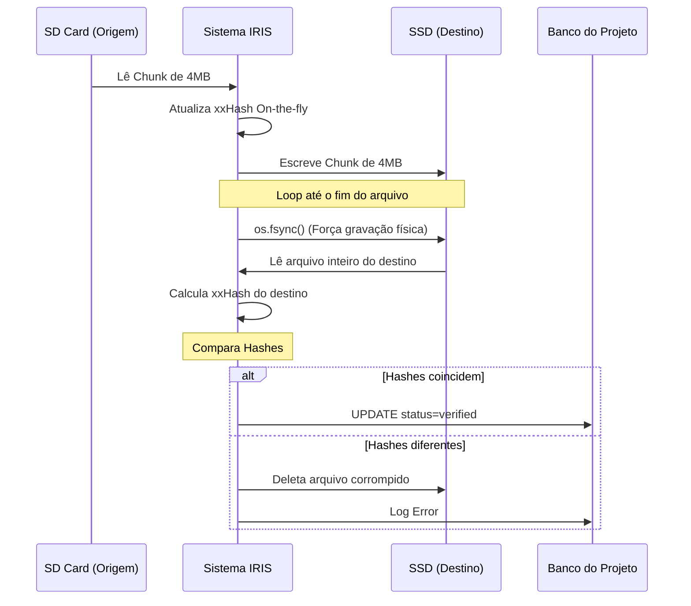

# Arquitetura de Ingestão Segura com Hash e Banco de Dados

Este documento detalha o "Estado da Arte" para a ingestão local de mídias pesadas (como fotos RAW e vídeos) utilizada no sistema **IRIS**. O foco é garantir a verificação da integridade de ponta a ponta (E2E) com o menor custo de I/O possível e alta resiliência a interrupções.

## O Problema

A cópia simples de um arquivo pode falhar silenciosamente (cabos USB danificados, setores defeituosos). A solução ingênua para garantir integridade é:
1. Ler o arquivo de origem e calcular o hash.
2. Copiar o arquivo da origem para o destino.
3. Ler o arquivo de destino e calcular o hash.
4. Comparar os hashes.

O gargalo dessa abordagem é exigir **3 leituras do disco** para cada arquivo, o que dobra ou triplica o tempo de backup em cenários de centenas de Gigabytes. 

Além disso, falhas no meio do processo (queda de energia) podem corromper sistemas de tracking baseados em JSON, além do tamanho do JSON em memória se tornar um problema com dezenas de milhares de arquivos.

## A Solução (Cópia Chunkada On-the-fly)

Para contornar o problema, o IRIS adota as seguintes técnicas em sua Etapa 1 (Ingestão):

### 1. Hash em Memória Simultâneo à Cópia
Em vez de ler o arquivo 3 vezes, nós lemos apenas **2 vezes**. O arquivo original é lido em blocos (chunks). Cada bloco é imediatamente injetado na função de hash e em seguida escrito no destino. Ao terminar de ler o arquivo de origem para a cópia, já temos seu hash calculado perfeitamente.

### 2. O Algoritmo `xxHash`
Usamos o `xxhash` (variante `xxh64`), um algoritmo não-criptográfico de extrema velocidade que funciona limitado apenas pela banda da memória RAM. Isso garante que o cálculo não retarde a leitura e escrita do disco, ao contrário do MD5 ou SHA-256.

### 3. Forçando a Escrita Física (`os.fsync`)
Para evitar que a leitura de verificação leia apenas o cache de I/O da memória RAM do Sistema Operacional, nós forçamos o "flush" dos buffers na controladora do disco físico utilizando `os.fsync()`. Isso nos dá a garantia de que o dado foi magneticamente/eletricamente gravado na mídia antes de abrirmos o arquivo para calcular o hash do destino.

## Arquitetura de Estado (Bancos de Dados)

O tracking da ingestão agora utiliza dois níveis de banco de dados SQLite para assegurar Atomicidade (ACID):

### Banco Central (`iris.db`)
Fica na pasta principal (ex: `C:\IRIS\projects`) e guarda informações globais:
- ID, Nome, e Caminhos (Source/Dest).
- Status atual das etapas (Ingestion, Cleanup).
- Datas de início e fim.

### Banco por Projeto (`[Nome_do_Projeto].db`)
Cada projeto (cada lote de fotos, ou pasta do cartão) tem um banco SQLite individual. Vantagens:
- **Resiliência e Performance:** O banco central não fica travado ou gigantesco.
- **Isolamento:** Facilita excluir sessões inteiras apenas apagando o arquivo `.db` junto com a pasta.
- **Campos Granulares:** Guarda o caminho do arquivo, tamanho, o hash (`xxh64`) gerado e uma flag binária `verified: TRUE/FALSE`.

## Fluxo da Ingestão

## Etapa 2: Cleanup Seguro
Como o estado é persistido atomicamente no SQLite local a cada arquivo, a etapa de exclusão é completamente desacoplada. Ao rodar, ela não precisa ler hashes de novo: ela busca os arquivos no Cartão SD, consulta no SQLite se `verified == 1`, e caso sim, tem autorização para realizar a exclusão.
