# Proposta 09: Decomposição do God Object `Project` (1.272 Linhas) e Aplicação do Princípio de Responsabilidade Única (SRP)

## Contexto e Localização do Problema

- **Arquivo**: [`src/core/project.py`](file:///c:/code/IRIS/iris/src/core/project.py)
- **Tamanho**: **1.272 linhas de código**
- **Princípio Afetado**: **Single Responsibility Principle (SOLID)** e **Separação de Preocupações (SoC)**

### O Que Existe Atualmente Dentro de `project.py`

O arquivo `src/core/project.py` tornou-se o clássico **"God Object"** do sistema, acumulando simultaneamente mais de 10 responsabilidades não relacionadas:

```mermaid
graph TD
    ProjectFile["src/core/project.py (1.272 linhas)"]
    
    ProjectFile --> R1["1. Gerenciamento de Conexões SQLite e PRAGMAs"]
    ProjectFile --> R2["2. Definição de DDL e Schemas do Banco Central"]
    ProjectFile --> R3["3. Definição de DDL e Schemas do Banco do Projeto"]
    ProjectFile --> R4["4. Scripts de Migração e ALTER TABLE ad-hoc"]
    ProjectFile --> R5["5. Dataclass ProjectItem e serialização"]
    ProjectFile --> R6["6. Entidade de Domínio Project (ciclo de vida, metadados)"]
    ProjectFile --> R7["7. Repositório CRUD de Itens Ingeridos (items)"]
    ProjectFile --> R8["8. Repositório CRUD de Timelapses (timelapses)"]
    ProjectFile --> R9["9. Repositório CRUD de Vídeos Editados (edited_videos)"]
    ProjectFile --> R10["10. Repositório CRUD de Empilhamento Lunar (astro_stacks)"]
    ProjectFile --> R11["11. Repositório CRUD de Wavelets Lunar (astro_sharpens)"]
    ProjectFile --> R12["12. Funções Globais de Consulta Central (list_central_*)"]
```



---

## Diagnóstico da Causa-Raiz

1. **Violação Grave de Camadas Arquiteturais**:
   - Por que o núcleo do sistema (`src/core/project.py`) precisa conhecer os detalhes de implementação do empilhamento do PlanetarySystemStacker (`output_tiff_paths_json`, `keep_percents`, `crop_size`, `shared_gain`) ou presets de wavelets do RegiStax?
   - Quando um novo módulo é adicionado ao IRIS (ex: módulo de visão computacional YOLO ou gerador de thumbnails), os desenvolvedores são forçados a editar `src/core/project.py`, adicionando mais 200 linhas de DDL e CRUD SQL.
   - Isso viola o **Open-Closed Principle (OCP)**: uma classe deve estar aberta para extensão, mas fechada para modificação.

2. **Dificuldade Extrema de Testes Unitários**:
   - É quase impossível testar a lógica de um `Project` isoladamente sem criar arquivos reais de banco de dados SQLite em disco.
   - Os testes de unidade existentes precisam executar inserções reais no disco local para qualquer asserção básica.

---

## Abordagens de Solução

### Abordagem A: "Arquitetura em Camadas com Repositórios Especializados" (Recomendada para Clean Architecture)
**Conceito**: Decompor o arquivo em responsabilidades focadas dentro de `src/core/`:
- `src/core/db.py`: Conexões, PRAGMAs, transações e gerenciador de contexto.
- `src/core/models.py`: Dataclasses de domínio (`ProjectItem`, `ProjectRecord`, etc.).
- `src/core/repositories/`:
  - `project_repository.py`: Ciclo de vida de projetos e listagens.
  - `item_repository.py`: CRUD e batching da tabela `items`.
  - `media_repository.py`: CRUD de timelapses e vídeos editados.
  - `astro_repository.py`: CRUD de stacks e sharpens.
- `src/core/project.py`: Torna-se uma classe de domínio enxuta (~150 linhas) que orquestra seus repositórios via injeção ou composição.

- **Vantagens**:
  - Código limpo, legível e em total conformidade com SOLID.
  - Cada arquivo passa a ter entre 80 e 200 linhas.
  - Permite criar repositórios falsos em memória (`MockItemRepository`) para testes unitários instantâneos.
- **Desvantagens**:
  - Requer organizar os imports em múltiplos arquivos.

---

### Abordagem B: "Armazenamento Descentralizado por Módulo (Feature-Owned Storage)" (Recomendada para Extensibilidade)
**Conceito**: O núcleo (`core`) gerencia apenas o projeto e os itens ingeridos (`items`). A responsabilidade de persistir dados de módulos específicos pertence ao **próprio módulo**:
- `src/modules/timelapse/storage.py`: Define a tabela `timelapses` e seus métodos de persistência.
- `src/modules/video_edit/storage.py`: Define a tabela `edited_videos`.
- `src/modules/astro_stack/storage.py`: Define a tabela `astro_stacks`.

Quando um módulo é carregado no pipeline, ele registra suas tabelas no banco de dados do projeto.

- **Vantagens**:
  - Máximo desacoplamento: se você remover ou desativar o módulo de astrofotografia, o `core` continua 100% íntegro sem carregar código morto de astro.
  - Novos módulos (como o classificador YOLO planejado no `TODO.md`) gerenciam sua própria persistência sem encostar no `core`.
- **Desvantagens**:
  - Exige um mecanismo de inicialização de hooks de schema quando os módulos são importados.

---

### Abordagem C: "Decomposição por Mixins (Baixo Impacto de Compatibilidade)"
**Conceito**: Manter a mesma API pública da classe `Project`, mas dividir seus métodos em mixins que herdados em `Project`:
```python
class Project(ProjectBase, ProjectItemsMixin, ProjectTimelapseMixin, ProjectAstroMixin):
    pass
```
- `ProjectBase` (150 linhas): metadados e ciclo de vida.
- `ProjectItemsMixin` (200 linhas): `save_item`, `get_items`, etc.
- `ProjectTimelapseMixin` (250 linhas): timelapses e vídeos.
- `ProjectAstroMixin` (250 linhas): stacks e wavelets.

- **Vantagens**:
  - **100% retrocompatível**: Nenhum código existente em nenhuma etapa do IRIS precisará alterar chamadas como `project.save_timelapse()`.
  - O arquivo monolítico de 1.272 linhas é eliminado imediatamente.
- **Desvantagens**:
  - Mixins continuam acoplando a mesma classe por herança múltipla, mas resolvem o problema de manutenibilidade visual de código.

---

## Tabela Comparativa

| Critério | Atual (Monólito 1.272 linhas) | Abordagem A (Repositórios) | Abordagem B (Feature-Owned) | Abordagem C (Mixins) |
| :--- | :---: | :---: | :---: | :---: |
| **Linhas por Arquivo** | 🔴 1.272 linhas | 🟢 100-200 linhas | 🟢 100-150 linhas | 🟢 200-300 linhas |
| **Conformidade com SOLID** | ❌ 0% | 🟢 100% | 🟢 100% | 🟡 Parcial |
| **Impacto em Código Existente** | — | Moderado | Moderado | **Zero (Transparente)** |
| **Testabilidade sem SQLite** | ❌ Não | 🟢 Total | 🟢 Total | ⚠️ Parcial |

---

## Recomendação de Roteiro

1. **Fase Imediata**: Adotar a **Abordagem C (Mixins)** para quebrar o arquivo de 1.272 linhas em módulos menores sem alterar nenhuma assinatura chamada pelos testes ou pelos 10 módulos do IRIS.
2. **Fase Estrutural**: Migrar gradualmente para a **Abordagem B (Feature-Owned Storage)** à medida que novos recursos do `TODO.md` forem implementados.
