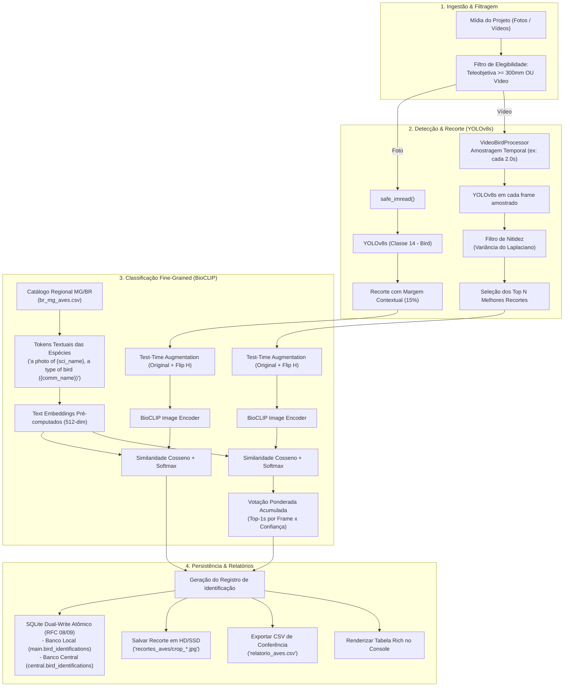

# Arquitetura e Plano de Evolução: Módulo de Identificação de Aves (IRIS Bird ID)

Este documento detalha o estado atual, a arquitetura interna em nível de engenharia e os próximos passos para a consolidação do módulo de identificação taxonômica de aves (`BirdIdStage` / `src.modules.bird_id`) no sistema IRIS.

---

## 1. Visão Geral do Módulo

O módulo **IRIS Bird ID** foi concebido para resolver o desafio de triagem e identificação taxonômica automatizada de fauna ornitológica em fotografias superzoom (teleobjetivas $\ge 300\text{mm}$, como a Canon PowerShot SX60 HS de até $1365\text{mm}$) e clipes de vídeo capturados em campo.

Diferente de classificadores monolíticos convencionais que falham quando o animal ocupa uma fração reduzida do enquadramento, o IRIS adota uma **arquitetura desacoplada em duas etapas (Two-Stage Pipeline)**:
1. **Detecção e Localização Espacial**: Localiza com precisão a ave na imagem de alta resolução e extrai um recorte com margem contextual de preservação de silhueta.
2. **Classificação Fine-Grained com Prior Geográfico**: Classifica o recorte ampliado usando modelos de visão fundacional biológica (BioCLIP) condicionados a uma lista de espécies com ocorrência geográfica verificada (prior regional de Minas Gerais / Brasil).



---

## 2. O Que Já Foi Feito e Já Está Funcionando

A Fase 0 (motor de IA, heurísticas de vídeo e persistência atômica) está totalmente implementada e coberta por testes automatizados com 100% de aprovação.

### Resumo do que está implementado e operacional:

| Componente | Arquivo de Origem | Funcionalidade e Estado Atual |
| :--- | :--- | :--- |
| **Detector de Presença** | [`detector.py`](file:///c:/code/IRIS/iris/src/modules/bird_id/detector.py) | **Funcionando**. Utiliza YOLOv8s (`yolov8s.pt`), filtra pela classe COCO `14` (bird), calcula score por confiança $\times$ área normalizada, aplica margem expansiva de 15% nas bordas para incluir cauda/bico e possui fallback seguro para ave centralizada se o detector falhar. Suporta caminhos com acentos no Windows via `safe_imread`/`safe_imwrite`. |
| **Classificador BioCLIP** | [`classifier.py`](file:///c:/code/IRIS/iris/src/modules/bird_id/classifier.py) | **Funcionando**. Carrega `hf-hub:imageomics/bioclip` (com fallback seguro para `ViT-B-32` LAION-2B). Pré-computa embeddings normalizados de 512 dimensões para todas as espécies do catálogo. Aplica **Test-Time Augmentation (TTA)** com espelhamento horizontal para mitigar variações de orientação da ave no galho/vôo. Retorna top-K predições ordenadas com probabilidades via softmax calibrada ($100 \times \text{sim}$). |
| **Catálogo Taxonômico Regional** | [`br_mg_aves.csv`](file:///c:/code/IRIS/iris/src/modules/bird_id/species_lists/br_mg_aves.csv) | **Funcionando**. Catálogo com 95 espécies frequentes de aves de Minas Gerais e Sudeste do Brasil, com nomenclatura binomial científica, nome popular em português (`common_name_pt`), família e ordem. |
| **Processador de Vídeo** | [`video_processor.py`](file:///c:/code/IRIS/iris/src/modules/bird_id/video_processor.py) | **Funcionando**. Amostra frames a intervalos configuráveis (`sample_interval_sec=2.0s`), descarta caixas menores que $40 \times 40\text{px}$, calcula a nitidez do recorte em tons de cinza através da **variância do operador Laplaciano** ($\text{Var}(\nabla^2 I)$), pondera pelo tamanho da ave ($\text{sharpness} \times \text{conf} \times \sqrt{\text{área}}$), seleciona os top 15 recortes mais nítidos do clipe e executa **votação ponderada acumulada** com distribuição percentual de votos por espécie. |
| **Persistência SQLite (Dual-Write)** | [`birds.py`](file:///c:/code/IRIS/iris/src/core/project_mixins/birds.py) e [`project.py`](file:///c:/code/IRIS/iris/src/core/project.py) | **Funcionando**. Tabela `bird_identifications` nos esquemas local e central com `UNIQUE(project_name, item_path)`, constraint `ON CONFLICT DO UPDATE`, salvamento de top-1, top-2 e top-3 com seus respectivos nomes populares, científicos e scores, flag `needs_review`, caminhos do crop de depuração e dicionário de auditoria em `metadata_json`. Consultas $O(1)$ via `get_bird_identifications_count()`. |
| **Gerador de Relatórios & UI** | [`reporter.py`](file:///c:/code/IRIS/iris/src/modules/bird_id/reporter.py) | **Funcionando**. Exportação automática para `relatorio_aves.csv` no diretório do projeto e exibição no console de tabela colorida Rich com destaque em vermelho para casos que demandam revisão manual (`needs_review=True`) e amarelo para confiança $< 65\%$. |
| **Estágio no Pipeline** | [`stage.py`](file:///c:/code/IRIS/iris/src/modules/bird_id/stage.py) | **Funcionando**. Classe `BirdIdStage` herdando de `PipelineStage`, integrada ao loop principal via `get_stage("bird_id", ...)`, utilizando `ProgressTracker` e painel `Live` vertical para feedback frame a frame. |
| **Suíte de Testes** | [`test_bird_id.py`](file:///c:/code/IRIS/iris/tests/test_bird_id.py) | **Funcionando (100% pass)**. 8 testes unitários cobrindo carregamento do estágio, catálogo CSV, cálculo de nitidez, mocks de inferência YOLO e BioCLIP, exportação CSV, projetos vazios e execução integrada com item simulado de superzoom (1200mm). |

---

## 3. Arquitetura e Pipeline em Detalhes

### 3.1. Detecção Espacial e Bounding Box Ponderada (`BirdDetector`)
O desafio central de aves em superzoom ou em ambientes arborizados é que a ave muitas vezes divide o espaço com folhagens ou aparece pequena na imagem de grande resolução (ex: $4608 \times 3456$ ou $4000 \times 3000$).
- O detector YOLOv8 avalia a imagem inteira com restrição estrita `classes=[14]` (classe de aves no dataset COCO).
- A seleção da caixa principal não utiliza apenas a confiança crua, mas o score composto:
  $$\text{Score} = \text{Confiança} \times \left(\frac{\text{Área}}{\text{Largura} \times \text{Altura}}\right)$$
- Após encontrar a melhor bounding box $(x_1, y_1, x_2, y_2)$, uma margem contextual de $15\%$ é calculada:
  $$\Delta x = 0.15 \times (x_2 - x_1), \quad \Delta y = 0.15 \times (y_2 - y_1)$$
  Isso garante que caudas longas (ex: Tesourinha, Anu-branco) ou penachos/topetes não sejam decepados pelo recorte.

### 3.2. Prior Regional e Classificação Zero-Shot (`BirdClassifier`)
Modelos genéricos de CLIP frequentemente confundem espécies neotropicais com espécies do hemisfério norte. O IRIS contorna esse problema através de **Constrained Zero-Shot Classification**:
- Em vez de buscar no vocabulário aberto de 10.000 aves do mundo, o modelo projeta os embeddings do recorte contra um espaço restrito composto exclusivamente pelas 95 espécies documentadas de ocorrência no bioma alvo (Minas Gerais / Sudeste).
- **Prompt Engineering**:
  $$\text{Prompt} = \text{"a photo of } \langle\text{scientific\_name}\rangle, \text{ a type of bird (}\langle\text{common\_name}\rangle\text{)}"$$
- **Pré-computação**: Na inicialização do estágio, todos os 95 textos são codificados e normalizados uma única vez em GPU/CPU ($\text{text\_features} \in \mathbb{R}^{95 \times 512}$), tornando a inferência em lote extremamente rápida (apenas a passagem do encoder visual do recorte por imagem).
- **Test-Time Augmentation (TTA)**:
  A ave é inferida em sua orientação original e espelhada horizontalmente:
  $$\mathbf{f}_{\text{final}} = \text{Normalize}\left(\frac{\mathbf{f}_{\text{orig}} + \mathbf{f}_{\text{flip}}}{2}\right)$$
  Isso aumenta a invariância à pose e melhora a precisão de identificação em galhos oblíquos.

### 3.3. Pipeline de Vídeo com Filtragem de Nitidez e Votação (`VideoBirdProcessor`)
Vídeos de aves apresentam trepidação de mão em superzoom e momentos em que a ave se move rapidamente ficando borrada (*motion blur*). A classificação cega de todos os quadros geraria alucinações e ruído.
- **Amostragem Temporal Espaçada**: Coleta 1 frame a cada $T$ segundos (padrão: 2.0s).
- **Filtro de Resolução Mínima**: Recortes com largura ou altura $< 40\text{px}$ são sumariamente rejeitados.
- **Métrica de Nitidez por Variância do Laplaciano**:
  $$\sigma^2_{\text{Lap}} = \frac{1}{HW}\sum_{x,y} \left(\nabla^2 I(x,y) - \mu_{\text{Lap}}\right)^2$$
- **Score de Qualidade do Frame**:
  $$S = \sigma^2_{\text{Lap}} \times \text{conf}_{\text{YOLO}} \times \sqrt{\text{Área}}$$
- **Votação Ponderada Acumulada**:
  Os top 15 melhores recortes têm suas probabilidades BioCLIP agregadas:
  $$W_{\text{espécie}} = \sum_{i \in \text{Crops}} \text{Top1Conf}_i \cdot \mathbb{I}(\text{Top1Espécie}_i = \text{espécie})$$
  A espécie predominante é calculada como a razão entre seu peso acumulado e a soma de todos os pesos, gerando um índice de confiança global confiável para o vídeo.

---

## 4. O Que Ainda Precisa Ser Feito (Gaps e Próximos Passos)

Embora o núcleo computacional de IA esteja pronto e testado, há lacunas de integração sistêmica, usabilidade e fluxo de trabalho no IRIS:

### 4.1. Integração e Posicionamento no Fluxo do Pipeline (Item pendente no TODO.md)
* **Estado Atual**: No `config.yaml`, o estágio `bird_id` está posicionado logo após o `organize` (Organização Física no SSD).
* **Gap**: 
  - Se ele roda após o `organize`, os arquivos já foram renomeados segundo o padrão genérico (`{date}_{time}_{camera}_...`) e distribuídos em pastas como `1_Fotos/` e `3_Videos/`.
  - O `bird_id` atualmente **não renomeia os arquivos** com o nome da ave identificada nem cria atalhos/pastas organizadas por espécie. O resultado fica apenas no banco SQLite e no `relatorio_aves.csv`.
* **Necessidade**: 
  - Avaliar o fluxo: Deve o `bird_id` rodar antes de `organize` para permitir que o `organize` já mova os arquivos para `2_Aves/{species_common}/` e inclua `_{species_common}_` no nome final?
  - Ou deve o `bird_id` rodar pós-`organize` e, caso configurado (`rename_files: true`), aplicar a renomeação in-place / movimentação para álbum de aves?

### 4.2. Suporte a Fotos em Formato RAW (`.CR2`, `.ARW`, `.DNG`)
* **Estado Atual**: No [`stage.py`](file:///c:/code/IRIS/iris/src/modules/bird_id/stage.py#L60-L65), a elegibilidade de fotos está restrita estritamente a:
  ```python
  elif ext in [".jpg", ".jpeg"]:
      if focal is None or is_telephoto:
          eligible_items.append((item, file_path, False))
  ```
* **Gap**: Usuários de câmeras avançadas e superzooms (como Canon SX60 ou DSLRs/Mirrorless) capturam aves frequentemente em RAW (`.CR2`). Esses arquivos são ignorados pelo módulo.
* **Necessidade**: Integrar extração rápida de preview JPEG embutido no RAW (via `exiftool` ou `rawpy`/`piexif`), ou decodificação RGB para que fotos RAW de aves também sejam classificadas.

### 4.3. Interface de Configuração no Hub (`config_menu.py`)
* **Estado Atual**: O menu interativo de configurações do IRIS possui 7 categorias temáticas (Armazenamento, Organização, Timelapse 4K, Edição de Vídeo, YouTube, Astrofotografia Lunar e Timelapse Longa Exposição).
* **Gap**: Não existe uma subpágina para o **Módulo de Identificação de Aves**. Para alterar parâmetros como `min_species_confidence`, `zoom_threshold_mm`, `video_sample_interval_seconds` ou `save_crops`, o usuário precisa editar o arquivo `config.yaml` manualmente.
* **Necessidade**: Criar a opção `8. 🦜 Identificação de Aves (YOLO + BioCLIP)` no `show_config_menu`.

### 4.4. Anotação de Metadados EXIF / XMP / IPTC
* **Estado Atual**: A identificação fica gravada no SQLite local e central e no CSV de revisão.
* **Gap**: Se o usuário importar a foto para o Adobe Lightroom, Apple Fotos, DigiKam ou Google Fotos, a imagem não contém a tag da espécie em seus metadados EXIF/IPTC (`Keywords`, `Subject`, `HierarchicalSubject`).
* **Necessidade**: Adicionar rotina opcional para injetar as tags taxonômicas (Nome Comum, Nome Científico, Família) diretamente nos metadados do arquivo organizado ou em sidecar XMP.

### 4.5. Expansão e Customização do Catálogo de Espécies
* **Estado Atual**: Fixado em `br_mg_aves.csv` (Minas Gerais).
* **Gap**: Se o usuário fizer uma expedição para o Pantanal, Amazônia, Litoral ou exterior, o classificador tentará aproximar para as aves de MG.
* **Necessidade**: Suporte a catálogos configuráveis por projeto (`catalog_csv_path`) e ferramenta de download/geração de checklists do eBird / WikiAves por estado/região.

### 4.6. Documentação Oficial no MkDocs
* **Estado Atual**: Os módulos 01 a 11 estão documentados em `docs/modulos/01-ingestao.md` a `11-cli-astro.md`.
* **Gap**: Falta criar o documento `docs/modulos/12-bird-id.md` e registrá-lo no `mkdocs.yml` sob "Módulos do Pipeline".

---

## 5. User Review Required

> [!IMPORTANT]
> **Decisão de Design 1: Momento e Comportamento da Renomeação dos Arquivos**
> Atualmente, as fotos e vídeos de aves são apenas identificados e registrados no banco SQLite/CSV. Como você prefere que a identificação se reflita no disco?
> - **Opção A (Recomendada - Não-destrutiva / Álbum ou Tag)**: Manter os arquivos físicos em seus locais de destino (`1_Fotos/` e `3_Videos/`), salvar os recortes em `recortes_aves/` e criar cópias/hardlinks ou pasta de coleção `10_Aves/{Especie_Comum}/` apenas para itens com confiança $\ge$ limiar (ex: 75%).
> - **Opção B (Renomeação In-Place)**: Alterar o nome do arquivo organizado no disco inserindo a espécie identificada (ex: `2026-09-06_15-10_SX60_1365mm_[Bem-te-vi]_IMG_1234.jpg`). Requer atualização dos registros no SQLite `items.organized_path`.
> - **Opção C (Apenas Metadados)**: Preservar estritamente os nomes originais dos arquivos e injetar palavras-chave IPTC/EXIF (`Keywords = ["Aves", "Bem-te-vi", "Pitangus sulphuratus"]`).

> [!NOTE]
> **Decisão de Design 2: Suporte a RAW para Aves**
> Para ler arquivos RAW (`.CR2`) no módulo de aves, a melhor abordagem em termos de performance é extrair o preview JPEG de alta resolução embutido no RAW (leva ~30ms via ExifTool / LibRaw) em vez de decodificar o mosaico Bayer completo (que levaria ~1.5s por foto). Deseja que adotemos a extração de preview embutido?

---

## 6. Open Questions

1. **Amostragem de Vídeo**: O intervalo padrão atual de 2.0 segundos entre frames amostrados atende seus clipes típicos de aves na Canon SX60 (que duram entre 10s e 60s), ou prefere um intervalo menor (ex: 1.0s para aves muito ativas)?
2. **Revisão Manual**: O relatório `relatorio_aves.csv` atual é suficiente para você conferir as dúvidas, ou gostaria de um comando CLI interativo (ex: `iris birds review`) para validar/aprovar visualmente as identificações marcadas com `needs_review=True`?

---

## 7. Proposta de Roadmap e Fases de Implementação

Dividimos a finalização e evolução do módulo em 3 fases estruturadas:

### Fase 1: Governança, Configurações e Documentação (Imediata)
- [ ] Implementar a subpágina interativa de configurações em [`config_menu.py`](file:///c:/code/IRIS/iris/src/core/config_menu.py) (Opção 8: Identificação de Aves).
- [ ] Criar a documentação técnica oficial [`docs/modulos/12-bird-id.md`](file:///c:/code/IRIS/docs/modulos/12-bird-id.md) e incluí-la no [`mkdocs.yml`](file:///c:/code/IRIS/mkdocs.yml).
- [ ] Atualizar o status do módulo e do roadmap no [`TODO.md`](file:///c:/code/IRIS/TODO.md).

### Fase 2: Suporte a RAW e Extração de Previews
- [ ] Expandir o filtro de elegibilidade em [`stage.py`](file:///c:/code/IRIS/iris/src/modules/bird_id/stage.py) para incluir extensões RAW (`.cr2`, `.cr3`, `.arw`, `.dng`).
- [ ] Implementar leitor rápido de preview JPEG embutido em arquivos RAW.
- [ ] Adicionar testes unitários dedicados para processamento de fotos RAW em [`test_bird_id.py`](file:///c:/code/IRIS/iris/tests/test_bird_id.py).

### Fase 3: Organização Física, Metadados EXIF e Ações Pós-Identificação
- [ ] Implementar a estratégia escolhida pelo usuário para reflexo no disco (Álbum de Aves `10_Aves/`, renomeação in-place ou anotação EXIF/XMP).
- [ ] Suporte a catálogos regionais adicionais no diretório `species_lists/`.

---

## 8. Plano de Verificação

### Testes Automatizados
- Executar `pytest iris/tests/test_bird_id.py -v` para garantir 100% de integridade em regressões.
- Executar `pytest iris/tests/test_config_menu.py -v` após inserção da nova subpágina no menu interativo.

### Testes Manuais
- Abrir o IRIS via `python iris/main.py`, navegar até `C (Configurações)` e verificar a renderização e persistência dos ajustes do novo menu de aves.
- Processar uma pasta de teste com fotos reais e vídeo de aves (usando os dados validados em `benchmark_species_results.csv`) para confirmar o fluxo completo.
